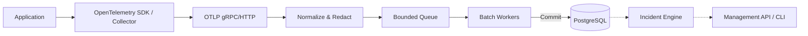

# Flight

Incident-centric observability and production replay for OpenTelemetry workloads.

Flight accepts standard OpenTelemetry data (traces and logs), detects failures, correlates them into actionable incidents, and enables safe request replay for debugging.

## Architecture Overview



## Repository Structure

```text
.
├── cmd/flight/             # Main binary and subcommands (serve, migrate)
├── configs/                # Example YAML configurations
├── docs/                   # Architecture, ADRs, security, and planning documentation
├── examples/               # Demo applications (e.g., synthetic trace producer)
├── internal/               # Core domain logic and bounded contexts
│   ├── config/             # Strict configuration loading and validation
│   ├── httpapi/            # Management HTTP server and middleware
│   ├── incident/           # Failure detection and deduplication
│   ├── ingest/otlp/        # OTLP receivers and protobuf normalization
│   ├── pipeline/           # Bounded ingestion pipeline and batching
│   ├── postgres/           # Database connections and event storage
│   └── telemetry/          # Canonical event model
├── migrations/             # Versioned PostgreSQL SQL migrations
├── Dockerfile              # Distroless, non-root container build
├── compose.yaml            # Docker Compose stack for local development
└── Makefile                # Build, test, and run tasks
```

## Quick Start (Docker)

To run the complete stack locally using Docker Compose:

```bash
docker compose up --build -d postgres
docker compose run --rm migrate
docker compose up -d flight
```

> **Note**: For detailed setup instructions, deployment guides, and API documentation, please refer to the `docs/` folder.

## License

Flight is licensed under the Apache License 2.0.
