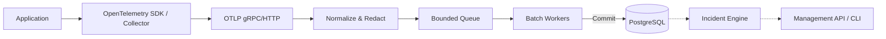

# Flight

Incident-centric observability and production replay for OpenTelemetry workloads.

Flight accepts standard OpenTelemetry data (traces and logs), detects failures, correlates them into actionable incidents, and enables safe request replay for debugging.

## Architecture Overview



## Repository Structure

```text
.
├── cmd/flight/             # Main binary and subcommands (serve, migrate)
├── configs/                # Example YAML configurations
├── docs/                   # Architecture, ADRs, security, and planning documentation
├── examples/               # Demo applications (e.g., synthetic trace producer)
├── internal/               # Core domain logic and bounded contexts
│   ├── config/             # Strict configuration loading and validation
│   ├── httpapi/            # Management HTTP server and middleware
│   ├── ingest/otlp/        # OTLP receivers and protobuf normalization
│   ├── pipeline/           # Bounded ingestion pipeline and batching
│   ├── postgres/           # Database connections and event storage
│   └── telemetry/          # Canonical event model
├── migrations/             # Versioned PostgreSQL SQL migrations
├── Dockerfile              # Distroless, non-root container build
├── compose.yaml            # Docker Compose stack for local development
└── Makefile                # Build, test, and run tasks
```

## Configuration

Flight is fully configured using environment variables. You can create a `.env` file in the root of the project to customize settings. 
For example:
```env
FLIGHT_LOG_LEVEL=debug
FLIGHT_HTTP_ADDRESS=:8080
```
Docker Compose also picks up this `.env` file automatically to configure PostgreSQL and other services.

## How to Run

Flight provides a `Makefile` with shortcuts to run the project effortlessly. You can choose to run it entirely in Docker or natively with Go.

### Option 1: Docker Compose (Recommended)
This is the fastest way to get everything running, including the database and migrations.

```bash
make dev
```
> **What this does:**
> 1. Starts a PostgreSQL database (`docker compose up --build -d postgres`).
> 2. Runs the database migrations (`docker compose run --rm migrate`).
> 3. Starts the Flight server on port `8080` (`docker compose up -d flight`).

To verify it's running, open: `http://localhost:8080/health/ready`

### Option 2: Native Go
If you prefer running the Go code locally for easier debugging:

1. **Start the database:**
```bash
docker compose up -d postgres
```

2. **Run migrations:**
```bash
make migrate
```

3. **Start the server:**
```bash
make run
```
> This will execute `go run ./cmd/flight serve`.

> **Note**: For detailed setup instructions, deployment guides, and API documentation, please refer to the `docs/` folder.

## License

Flight is licensed under the Apache License 2.0.
