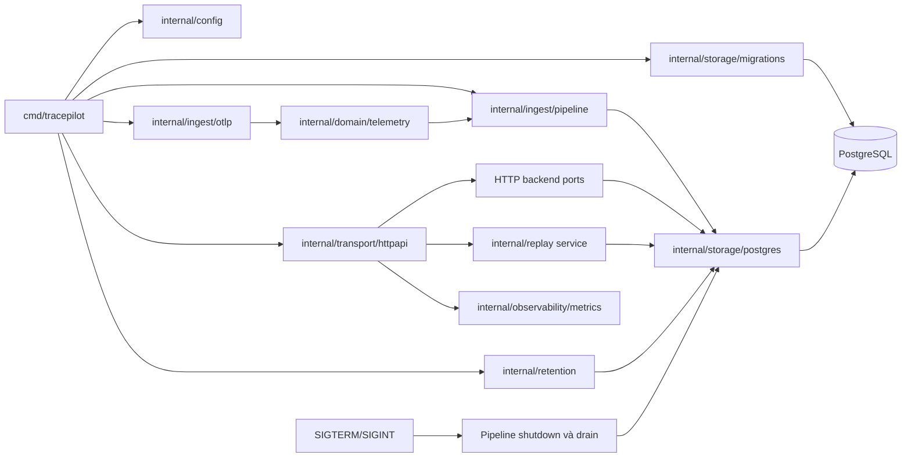
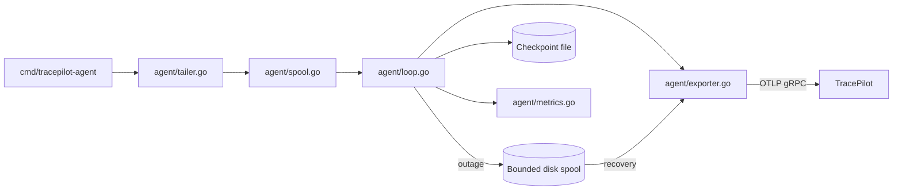
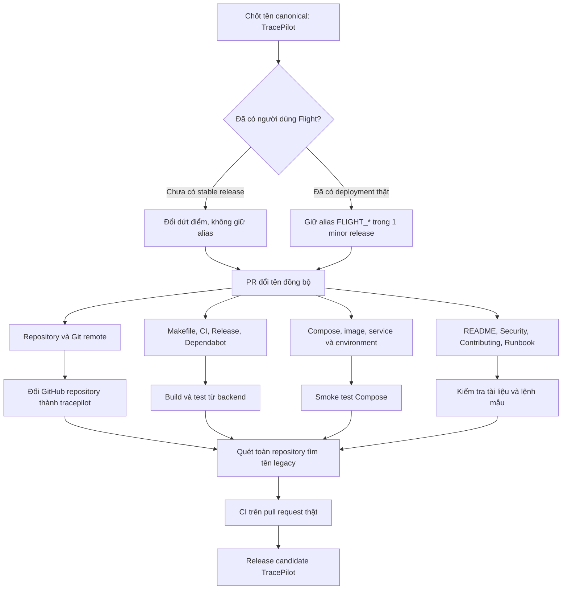
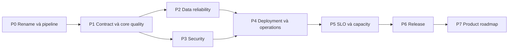

# TracePilot Production Readiness Checklist

Tài liệu này là kế hoạch phát triển và điều kiện nghiệm thu để đưa TracePilot
lên production. Đây không phải báo cáo rằng mọi mục đã hoàn thành.

## Phạm vi v1

TracePilot v1 là backend self-hosted cho OpenTelemetry traces và logs:

- nhận OTLP qua HTTP và gRPC;
- redact dữ liệu nhạy cảm;
- queue, batch, retry và lưu PostgreSQL;
- cung cấp API tìm kiếm trace/log, service và incident;
- cung cấp API key, scope, project/environment isolation;
- replay có bảo vệ SSRF và audit;
- file log agent có spool/checkpoint;
- healthcheck, readiness và Prometheus metrics;
- minimal browser UI.

OTLP metrics, alerting nâng cao và UI quản trị đầy đủ thuộc roadmap sau core
go-live, trừ khi product scope được thay đổi rõ ràng.

## Luồng source hiện tại

### Luồng server



### Luồng agent



## Bản đồ file và trách nhiệm

```text
backend/
├── db/
│   ├── migrations/           PostgreSQL schema history
│   └── queries/              SQLC query source
└── internal/
    ├── agent/                file log agent
    ├── auth/                 principals and API-key policy/models
    ├── config/               runtime configuration
    ├── domain/
    │   ├── incident/         incident models and pure policy
    │   ├── replay/           replay result/history models
    │   └── telemetry/        canonical trace/log event model
    ├── ingest/
    │   ├── otlp/             OTLP HTTP/gRPC transport and normalization
    │   └── pipeline/         bounded ingest queue and persistence workers
    ├── observability/metrics/ Prometheus instrumentation
    ├── query/                trace/log/service read models and filters
    ├── replay/               safe HTTP replay
    ├── retention/            retention worker and batched deletion flow
    ├── storage/
    │   ├── migrations/       schema version and migration runner
    │   └── postgres/         PostgreSQL persistence and generated SQLC code
    └── transport/httpapi/    authenticated HTTP management API

```

## Thứ tự đọc source đề xuất

1. `cmd/tracepilot/serve.go`: xem composition root và toàn bộ component được nối với nhau thế nào.
2. `internal/domain/telemetry/event.go`, `internal/auth/auth.go`, `internal/domain/incident/incident.go`: hiểu model và policy thuần trước khi đọc I/O.
3. `internal/ingest/otlp/receiver.go` rồi `trace_normalizer.go`/`log_normalizer.go`: theo request OTLP thành canonical event.
4. `internal/ingest/pipeline/pipeline.go`: theo admission → queue → batch → retry → commit acknowledgement.
5. `internal/storage/postgres/pool.go` và `incidents.go`: xem transaction lưu event/signal và incident projection.
6. `internal/transport/httpapi/backend.go`, `server.go`, rồi từng handler: xem inbound HTTP chỉ phụ thuộc port và domain/query models.
7. `internal/replay/service.go` rồi `capture/request.go`, `policy.go`, `executor.go`: theo orchestration và security boundary của replay.
8. `internal/retention/runner.go`: xem background flow độc lập khỏi composition root.
9. Đọc test cạnh mỗi flow ngay sau production file tương ứng; integration test là điểm nối cuối cùng.

### Entrypoint

| File | Nhiệm vụ |
|---|---|
| `cmd/tracepilot/main.go` | Parse command cấp cao và điều hướng `serve`, `migrate`, `healthcheck`, `version`. |
| `cmd/tracepilot/serve.go` | Composition root: load config, kiểm tra schema, mở DB, tạo pipeline/OTLP/API/replay/retention và điều phối graceful shutdown. |
| `cmd/tracepilot/migrate.go` | Parse và chạy lệnh migration `up`, `down`, `version`. |
| `cmd/tracepilot/mockdata.go` | Seed dữ liệu demo idempotent cho local/development. |
| `cmd/tracepilot/healthcheck.go` | Gọi readiness endpoint; hỗ trợ HTTPS, CA và TLS server name cho container/probe. |
| `cmd/tracepilot-agent/main.go` | Parse agent flags/secrets, khởi tạo exporter, metrics server và vòng tail log. |

### Config, model và runtime core

| File | Nhiệm vụ |
|---|---|
| `internal/config/config.go` | Khai báo cấu trúc config và thứ tự load defaults → YAML → environment. |
| `internal/config/defaults.go` | Chứa default an toàn và giới hạn mặc định. |
| `internal/config/env.go` | Ánh xạ `TRACEPILOT_*` vào config và parse kiểu dữ liệu. |
| `internal/config/validate.go` | Validate trust boundary: DB, queue, TLS, auth, replay, CORS và production mode. |
| `internal/domain/telemetry/event.go` | Canonical event/span/log model, validation và deterministic event ID. |
| `internal/auth/auth.go` | Principal, API-key models/errors và validation policy độc lập khỏi PostgreSQL. |
| `internal/domain/incident/incident.go` | Incident models, candidate/fingerprint/title/severity và status transition policy. |
| `internal/domain/replay/replay.go` | Replay result, execution history và pagination filter không phụ thuộc executor/storage. |
| `internal/query/models.go` | Read models/filter cho trace, log và service queries. |
| `internal/ingest/pipeline/pipeline.go` | Bounded in-memory queue, byte admission, batching, workers, retry, acknowledgement và shutdown drain. |
| `internal/retention/runner.go` | Vòng retention, backlog metrics và xóa event hết hạn theo batch. |
| `internal/observability/metrics/metrics.go` | Registry Prometheus cho ingest, queue, batch, retry, retention, HTTP và DB readiness. |
| `internal/storage/migrations/migrations.go` | Mở migration source, chạy up/down và chặn startup khi schema dirty/sai version. |

### OTLP ingestion

| File | Nhiệm vụ |
|---|---|
| `internal/ingest/otlp/server.go` | Khởi động/dừng đồng thời OTLP HTTP và gRPC listener, TLS và readiness. |
| `internal/ingest/otlp/receiver.go` | Authenticate ingest, normalize request, submit pipeline và trả partial/retryable result. |
| `internal/ingest/otlp/http.go` | HTTP handlers cho traces/logs, decode protobuf/JSON, giới hạn body và API key. |
| `internal/ingest/otlp/grpc.go` | Tạo gRPC server, giới hạn message, TLS và lấy API key từ metadata. |
| `internal/ingest/otlp/normalizer.go` | Điều phối chuẩn hóa OTLP, redact attributes và validate identifier/text. |
| `internal/ingest/otlp/trace_normalizer.go` | Chuyển OTLP span thành canonical telemetry event. |
| `internal/ingest/otlp/log_normalizer.go` | Chuyển OTLP log record thành canonical telemetry event. |
| `internal/ingest/otlp/attributes.go` | Chuyển OTLP AnyValue sang Go value có giới hạn depth/size và redaction. |

### Management API

| File | Nhiệm vụ |
|---|---|
| `internal/transport/httpapi/server.go` | Khai báo routes, HTTP server/TLS, health, readiness và metrics endpoint. |
| `internal/transport/httpapi/backend.go` | Port mà HTTP adapter sử dụng; ngăn transport phụ thuộc concrete PostgreSQL. |
| `internal/transport/httpapi/middleware.go` | Access log, request ID, metrics, body limit, CORS và panic recovery. |
| `internal/transport/httpapi/response.go` | Decode JSON nghiêm ngặt và chuẩn hóa JSON/error response. |
| `internal/transport/httpapi/auth.go` | Authenticate API key và enforce scope cho handler. |
| `internal/transport/httpapi/pagination.go` | Parse filter/time range/cursor, validate ID và tạo paginated response. |
| `internal/transport/httpapi/traces.go` | Endpoints list/get trace và lấy logs liên quan trace. |
| `internal/transport/httpapi/logs.go` | Endpoints list/get log. |
| `internal/transport/httpapi/services.go` | Endpoints service summary và service dependency. |
| `internal/transport/httpapi/incidents.go` | Incident list/detail/timeline/status và replay execution history. |
| `internal/transport/httpapi/replays.go` | Decode/sanitize request, gọi replay use case và map kết quả sang HTTP. |
| `internal/transport/httpapi/api_keys.go` | API key list/create/rotate/revoke và audit event endpoint. |
| `internal/transport/httpapi/openapi.go` | Sinh OpenAPI document được expose bởi management server. |

### Storage: PostgreSQL repository

| File | Nhiệm vụ |
|---|---|
| `internal/storage/postgres/pool.go` | Tạo pgx pool, readiness, bootstrap scope và transaction lưu event/span/log/incident. |
| `internal/storage/postgres/trace_queries.go` | List trace summaries qua pgx và lấy span của một trace qua SQLC. |
| `internal/storage/postgres/log_queries.go` | Tìm kiếm/list/get log trong project/environment. |
| `internal/storage/postgres/service_queries.go` | Service summaries và dependency graph queries. |
| `internal/storage/postgres/incidents.go` | Transaction tạo/deduplicate incident và cập nhật status theo domain policy. |
| `internal/storage/postgres/incident_queries.go` | Incident detail, occurrences, events và status history queries. |
| `internal/storage/postgres/replays.go` | Ghi lifecycle và truy vấn replay executions; dọn execution bị stale. |
| `internal/storage/postgres/api_keys.go` | Sinh/hash, create/list/rotate/revoke API key và ghi audit event. |
| `internal/storage/postgres/auth.go` | Bootstrap và authenticate API key, trả principal/scopes. |
| `internal/storage/postgres/retention.go` | Đếm và xóa event hết hạn theo batch. |
| `db/queries/*.sql` | SQLC source cho service/dependency và trace span query; dùng named parameter bắt buộc. |
| `internal/storage/postgres/sqlc/*.go` | Go code generated từ query SQL; không chỉnh sửa thủ công. |
| `internal/storage/postgres/sqlc_adapter.go` | Chuyển project/environment UUID và optional time thành pgx types cho generated query. |

### Replay

| File | Nhiệm vụ |
|---|---|
| `internal/replay/capture/request.go` | Sanitize captured HTTP request, bỏ credential và redact JSON nhạy cảm. |
| `internal/replay/policy.go` | Host allowlist, DNS/IP validation, chặn private address/redirect để bảo vệ SSRF. |
| `internal/replay/executor.go` | Thực thi replay có timeout, concurrency/response limit và tạo audit-safe target. |
| `internal/replay/service.go` | Orchestrate start → execute → complete và bảo đảm audit được hoàn tất khi request bị hủy. |

### File log agent

| File | Nhiệm vụ |
|---|---|
| `internal/agent/loop.go` | Điều phối dequeue spool, tail file, export và commit checkpoint. |
| `internal/agent/tailer.go` | Đọc log tăng dần, nhận biết truncate/replace và giới hạn line/batch. |
| `internal/agent/spool.go` | Encode/decode batch và bounded disk queue giữ dữ liệu khi outage. |
| `internal/agent/exporter.go` | Chuyển batch thành OTLP logs và gửi bằng gRPC/TLS/API key. |
| `internal/agent/metrics.go` | Prometheus metrics riêng cho read/export/spool/skipped lines. |
| `internal/agent/file.go` | Ghi checkpoint/spool file với permission riêng tư và atomic replacement. |

### Database migrations

Mỗi migration có cặp `.up.sql` và `.down.sql`; file down đảo thay đổi của file
up tương ứng.

| Migration | Nhiệm vụ |
|---|---|
| `000001_core` | Schema nền: project, environment, service, event, incident, API key, replay và indexes ban đầu. |
| `000002_signal_records` | Thêm bảng/index first-class cho spans và logs. |
| `000003_incident_idempotency` | Ngăn một event tạo trùng incident occurrence. |
| `000004_incident_status_changes` | Thêm lịch sử thay đổi incident status và actor API key. |
| `000005_api_key_events` | Thêm audit trail create/rotate/revoke API key. |
| `000006_log_search_index` | Bật `pg_trgm` và GIN index cho tìm kiếm log body. |
| `000007_remove_unused_payload_artifacts` | Xóa payload artifact/reference không còn dùng, có guard chống mất dữ liệu. |
| `000008_remove_unused_api_key_last_used_at` | Xóa `last_used_at` không dùng, có guard khi còn dữ liệu. |

### Build và dependency metadata

| File | Nhiệm vụ |
|---|---|
| `Dockerfile` | Multi-stage build hai binary, copy db/migrations và chạy distroless non-root. |
| `.dockerignore` | Loại file không cần khỏi Docker build context. |
| `go.mod` | Khai báo module, Go version và direct/indirect dependencies. |
| `go.sum` | Khóa checksum dependency để build có thể kiểm chứng. |
| `sqlc.yaml` | Cấu hình sqlc v1.31.1 dùng PostgreSQL migrations làm schema và pgx/v5 làm driver. |
| `PRODUCTION_CHECKLIST.md` | Source map, kế hoạch hardening và production gates. |

### Deployment assets ở repository root

| File | Nhiệm vụ |
|---|---|
| `deploy/compose.dev.yaml` | Local development stack gồm PostgreSQL, migration job và TracePilot. Không phải production manifest. |
| `deploy/.env.example` | Giá trị development để copy thành `deploy/.env`; không chứa secret production. |

### Test files

| Nhóm file | Trách nhiệm kiểm thử |
|---|---|
| `cmd/tracepilot/*_test.go` | CLI healthcheck và TLS SAN. |
| `cmd/tracepilot-agent/*_test.go` | Nguồn API key và chống cấu hình secret mơ hồ. |
| `internal/config/*_test.go` | Thứ tự config, unknown field và validation production/security/resource. |
| `internal/domain/telemetry/*_test.go` | Tính ổn định của deterministic event ID. |
| `internal/auth/*_test.go` | Principal scopes và API-key input policy. |
| `internal/domain/incident/*_test.go` | Incident candidate/fingerprint/severity và status transitions. |
| `internal/architecture/*_test.go` | Chặn dependency ngược giữa transport/ingest/storage adapters. |
| `internal/ingest/pipeline/*_test.go` | Ack-after-store, bounded queue, outage recovery, retry và shutdown drain. |
| `internal/ingest/otlp/*_test.go` | Normalize/redact, HTTP/gRPC persistence, body limit, failure và readiness. |
| `internal/transport/httpapi/*_test.go` | Router/middleware, CORS, metrics auth, pagination, isolation và API key lifecycle. |
| `internal/storage/postgres/*_test.go` | Idempotency, rollback recovery, cascade, SQLC query integration và benchmark. |
| `internal/storage/migrations/*_test.go` | Chặn migration operation nguy hiểm và schema version validation. |
| `internal/replay/*_test.go` | SSRF policy, redirect/timeout/response bounds và audit result. |
| `internal/retention/*_test.go` | Retention drain, cancellation và delete errors. |
| `internal/replay/capture/*_test.go` | Redact request body/header và loại credential. |
| `internal/agent/*_test.go` | Tail/rotate/truncate, spool durability, corrupt record và checkpoint correctness. |

## Trạng thái hiện tại

### Đã có trong backend

- [x] Go module `github.com/vanquan3008/tracepilot`.
- [x] Command `tracepilot` và `tracepilot-agent`.
- [x] Runtime environment dùng namespace `TRACEPILOT_*`.
- [x] API key prefix `tracepilot_`.
- [x] Prometheus metrics dùng namespace `tracepilot_*`.
- [x] OTLP traces/logs qua HTTP và gRPC.
- [x] PostgreSQL migrations và schema version guard.
- [x] Bounded queue, batch persistence, retry và graceful drain.
- [x] API key scopes và project/environment isolation.
- [x] Replay allowlist, SSRF protection và audit.
- [x] Agent spool/checkpoint và xử lý record quá kích thước.
- [x] Health, readiness và TLS-aware healthcheck.
- [x] Container backend chạy non-root.

### Chưa đồng bộ ở cấp repository

- [ ] GitHub repository/remote vẫn mang tên `flight-recorder`; chỉ đổi remote
      local sau khi GitHub repository `tracepilot` đã được tạo hoặc đổi tên.
- [x] README, security policy, contributing guide và operations runbook dùng
      TracePilot.
- [x] Compose dùng service/image/volume và biến `TRACEPILOT_*`.
- [x] Makefile build Go module từ `backend/`.
- [x] CI dùng `backend/go.mod` và chạy Go commands trong backend.
- [x] Release tạo artifact `tracepilot-*` và build Docker context `backend/`.
- [x] Dependabot quét Go module tại `/backend`.

## Luồng đổi tên



### Mapping canonical

| Thành phần | Legacy | Canonical |
|---|---|---|
| Repository | `flight-recorder` | `tracepilot` |
| Product | `Flight` | `TracePilot` |
| Binary | `flight`, `flight-agent` | `tracepilot`, `tracepilot-agent` |
| Environment | `FLIGHT_*` | `TRACEPILOT_*` |
| Compose service | `flight` | `tracepilot` |
| Image | `flight:*` | `tracepilot:*` |
| Release artifact | `flight-linux-*` | `tracepilot-linux-*` |
| Go command | `./cmd/flight` | `./backend/cmd/tracepilot` |
| Go working directory | repository root | `backend/` |
| Docker build context | `.` | `backend/` |
| Metrics trong tài liệu | `flight_*` | `tracepilot_*` |

Không đổi cưỡng bức database, user hoặc volume PostgreSQL của deployment đang
chạy. Deployment mới dùng tên TracePilot; deployment cũ có thể giữ identifier
Flight để tránh migration dữ liệu không cần thiết.

## Thứ tự thực hiện



## P0 — Đồng bộ rename và khôi phục pipeline

### Compatibility

- [ ] Xác nhận đã có deployment Flight thực tế hay chưa.
- [ ] Nếu chưa có stable release, đổi tên dứt điểm và không giữ legacy alias.
- [ ] Nếu đã có người dùng, hỗ trợ `FLIGHT_*` đúng một minor release.
- [ ] Alias phải log một deprecation warning lúc startup.
- [ ] Ghi quyết định compatibility vào một ADR ngắn.

### Repository và automation

- [ ] Đổi GitHub repository thành `tracepilot`.
- [ ] Cập nhật Git remote, clone URL, badge, package và security link.
- [ ] Kiểm tra lại branch protection và tên GHCR image.
- [x] Sửa Makefile để chạy Go trong `backend/`.
- [x] Build đúng `backend/cmd/tracepilot` và `tracepilot-agent`.
- [x] Cho setup-go đọc `backend/go.mod` và cache theo `backend/go.sum`.
- [x] Cho Dependabot quét Go module tại `/backend`.
- [x] Cấu hình CI chạy test, vet, race, staticcheck và govulncheck từ backend.
- [x] Xuất coverage đúng đường dẫn backend.
- [x] Build Docker CI/release với context `backend/`.
- [x] Cấu hình release artifact `tracepilot-*`.

### Runtime và tài liệu

- [x] Đổi Compose service và image sang TracePilot.
- [x] Đổi runtime configuration sang `TRACEPILOT_*`.
- [x] Đổi container healthcheck sang `/tracepilot healthcheck`.
- [x] Thêm `.env.example` không chứa secret thật.
- [x] Cập nhật README theo cấu trúc `backend/`.
- [x] Cập nhật security policy, contributing guide và operations runbook.
- [ ] Quét toàn repository cho `flight`, `FLIGHT_` và `cmd/flight`.
- [ ] Chỉ giữ tên legacy trong compatibility test có chủ đích.

### Gate P0

- [ ] Clean clone chạy được `make ci`.
- [ ] Compose build, migrate, start và healthcheck thành công.
- [ ] CI xanh trên pull request thật.
- [ ] Release dry-run tạo đúng binary và checksum.
- [ ] Không còn build step phụ thuộc Go module ở repository root.

## P1 — Ổn định contract và core quality

- [ ] Chốt v1 chỉ hỗ trợ OTLP traces và logs.
- [ ] Chuẩn hóa error response: code, message và request ID.
- [ ] Hoàn thiện OpenAPI với request/response schema thực tế.
- [ ] Khai báo đầy đủ pagination, filter, limit và example.
- [ ] Thêm contract test giữa router và OpenAPI.
- [ ] Xác định API versioning và deprecation policy.
- [ ] Kiểm tra giới hạn request body cho HTTP và gRPC.
- [ ] Xác định hành vi với duplicate OTLP events.
- [ ] Kiểm tra API key create, revoke, rotate và scope.
- [ ] Kiểm thử chéo project/environment không rò dữ liệu.
- [ ] Chuẩn hóa config reference và validation lúc startup.
- [ ] Bổ sung version/build metadata cho server và agent.
- [ ] Xóa dead code, config không dùng và legacy alias hết hạn.

### Gate P1

- [ ] Public API có contract rõ và có test bảo vệ.
- [ ] Không có config âm thầm bị bỏ qua.
- [ ] Không có cross-project access.
- [ ] `go test -race ./...` chạy ổn định.

## P2 — PostgreSQL và độ tin cậy dữ liệu

- [ ] Tự động hóa kiểm thử PostgreSQL outage và recovery.
- [ ] Kiểm thử shutdown khi queue còn dữ liệu.
- [ ] Xác nhận queue drain hoàn tất hoặc timeout có metric/log rõ ràng.
- [ ] Thực hiện backup/restore drill trên database disposable.
- [ ] Migration up/down/up với dữ liệu synthetic gần production.
- [ ] Kiểm tra startup khi schema dirty hoặc sai version.
- [ ] Test agent crash/restart và phục hồi spool/checkpoint.
- [ ] Kiểm tra retention không gây lock kéo dài hoặc phình WAL.
- [ ] Benchmark insert batch với nhiều kích thước.
- [ ] Chạy `EXPLAIN ANALYZE` cho truy vấn trace/log/service chính.
- [ ] Chỉ bổ sung index dựa trên query và benchmark thực tế.
- [ ] Định nghĩa RPO và RTO.
- [ ] Restore verification phải kiểm tra row count, trace lookup và audit data.
- [ ] Xác định migration compatibility N/N-1.

### Gate P2

- [ ] Mất PostgreSQL không gây crash-loop mất kiểm soát.
- [ ] Sau recovery, ingest tự động tiếp tục.
- [ ] Shutdown không mất dữ liệu ngoài giới hạn đã công bố.
- [ ] Restore đạt RPO/RTO.
- [ ] Migration rollback có bằng chứng kiểm thử.

## P3 — Security hardening

- [ ] Hoàn thiện threat model cho ingest, query, replay và agent.
- [ ] Xác nhận TLS certificate SAN tương thích healthcheck.
- [ ] Production từ chối cấu hình insecure.
- [ ] Secret chỉ đến từ secret manager hoặc file mount an toàn.
- [ ] Không log API key, DSN hoặc telemetry nhạy cảm.
- [ ] Test replay SSRF với redirect, DNS rebinding và private ranges.
- [ ] Test file agent chống path traversal và symlink ngoài phạm vi.
- [ ] Xác định rate limit cho query, replay và auth endpoint.
- [ ] Thiết lập CORS và security headers rõ ràng.
- [ ] Xác định quyền truy cập `/metrics`.
- [ ] Xác định retention cho API-key/replay audit.
- [ ] Công bố security contact được giám sát.
- [ ] Pin toàn bộ GitHub Actions bằng commit SHA.
- [ ] Chạy govulncheck, container scan và dependency license check.

### Gate P3

- [ ] Không còn secret mặc định trong production.
- [ ] Replay vẫn disabled mặc định.
- [ ] Container chạy non-root và read-only.
- [ ] Security checks phù hợp được chạy trong CI.

## P4 — Deployment và operations

- [ ] Chọn đúng một deployment target đầu tiên: Compose hoặc Kubernetes.
- [ ] Tạo cấu hình production riêng, không dùng dev defaults.
- [ ] Không expose PostgreSQL ra public network.
- [ ] Dùng managed PostgreSQL hoặc private network.
- [ ] Mô tả rõ TLS termination và internal transport.
- [ ] Khai báo CPU/memory requests và limits.
- [ ] Cấu hình persistent storage cho agent spool khi cần.
- [ ] Phân biệt mục đích readiness và liveness.
- [ ] Kiểm thử rolling deployment với queue đang hoạt động.
- [ ] Viết quy trình deploy, application rollback và database rollback.
- [ ] Viết runbook outage, disk full, high latency và queue saturation.
- [ ] Schedule backup và diễn tập restore định kỳ.
- [ ] Không mount Docker socket hoặc cấp host permission không cần thiết.

## P5 — Observability, capacity và SLO

- [ ] Định nghĩa SLI/SLO cho ingest availability và query latency.
- [ ] Dashboard ingest rate, rejected events, queue depth và retry.
- [ ] Dashboard PostgreSQL latency, pool saturation và disk growth.
- [ ] Dashboard agent spool size và send failures.
- [ ] Alert queue gần đầy.
- [ ] Alert PostgreSQL unavailable.
- [ ] Alert migration/schema mismatch.
- [ ] Alert backup thất bại hoặc quá hạn.
- [ ] Load test đồng thời traces và logs.
- [ ] Soak test ít nhất một chu kỳ retention.
- [ ] Xác định capacity theo events/second và bytes/day.
- [ ] Công bố giới hạn đã đo thay vì giả định khả năng scale.

## P6 — Release và supply chain

- [ ] Áp dụng semantic version và changelog.
- [ ] Build Linux AMD64/ARM64 binaries.
- [ ] Build multi-arch OCI image.
- [ ] Sinh SHA256 checksums.
- [ ] Sinh SBOM cho binary và image.
- [ ] Ký image và tạo build provenance.
- [ ] Production deploy bằng immutable image digest.
- [ ] Release workflow chỉ chạy sau toàn bộ CI.
- [ ] Artifact smoke test phải thực sự chạy binary.
- [ ] Test fresh install.
- [ ] Test upgrade từ version trước.
- [ ] Test application rollback với schema tương thích.
- [ ] Phát hành release candidate trước stable release.
- [ ] Chạy toàn bộ CI trên branch và pull request thật.

## P7 — Product roadmap sau core go-live

Roadmap machine-log/firewall analytics, detection và giao diện operator được
theo dõi riêng tại `docs/SECURITY_ANALYTICS_PLAN.md` để không trộn feature scope
với production gates của core observability.

- [ ] UI quản lý project, environment và API key.
- [ ] Trace waterfall và log correlation nâng cao.
- [ ] Saved searches.
- [ ] Incident workflow và webhook.
- [ ] Alert rules.
- [ ] Export/delete dữ liệu theo project.
- [ ] Quota theo project.
- [ ] Onboarding guide cho OpenTelemetry SDK/Collector.
- [ ] Chỉ thêm Helm chart khi Kubernetes là deployment target.
- [ ] Chỉ thêm OTLP metrics khi được xác nhận trong product scope.

## Production Definition of Done

- [ ] Không còn tên legacy ngoài compatibility có chủ đích.
- [ ] Clean clone build/test được bằng lệnh đã công bố.
- [ ] CI và release chạy xanh trên GitHub thật.
- [ ] PostgreSQL không public.
- [ ] TLS/SAN healthcheck hoạt động.
- [ ] Outage, queue drain, backup/restore và rollback drill đều đạt.
- [ ] Không còn security finding critical chưa được xử lý.
- [ ] Dashboard, alert và runbook đủ để xử lý sự cố.
- [ ] Deploy và rollback một release đã được diễn tập.
- [ ] Không phụ thuộc thao tác thủ công chưa được ghi lại.

## Nguyên tắc giữ hệ thống gọn

- PostgreSQL là stateful dependency duy nhất cho tới khi benchmark chứng minh
  cần thêm broker hoặc cache.
- Không triển khai đồng thời Compose và Kubernetes; chọn một target production.
- Không thêm abstraction, dependency hoặc service cho nhu cầu chưa đo được.
- Mỗi phase chỉ hoàn thành khi toàn bộ gate của phase đó có bằng chứng kiểm thử.
