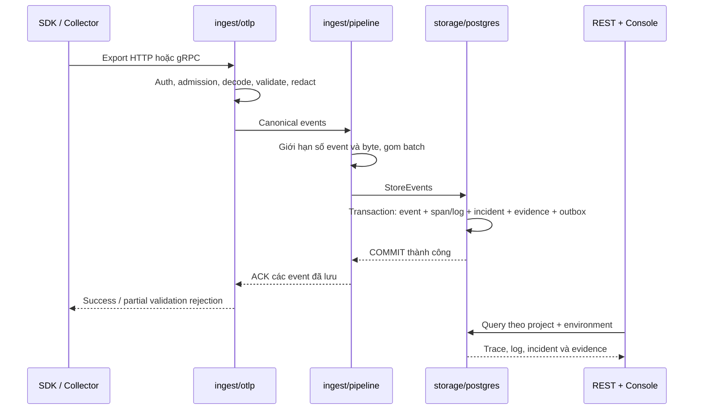

# Kiến trúc và flow TracePilot

Đối chiếu working tree ngày 13/10/2026. Hướng đã chọn: một ứng dụng Go,
React embed vào binary và PostgreSQL riêng. Trạng thái kiểm chứng ở
[REVIEW.md](REVIEW.md); điều kiện triển khai ở [OPERATIONS.md](OPERATIONS.md).

## Source theo trách nhiệm

```text
backend/
  cmd/tracepilot/             CLI, startup, wiring, shutdown, lịch partition
  internal/
    application/
      incident/              Use case đổi trạng thái và validation actor
      intelligence/          Lịch detector, ngoài đường ACK
      notification/          Webhook delivery, HMAC, outbound policy
      replay/                Replay use case, executor, allowlist, capture
      retention/             Lịch và vòng lặp dọn dữ liệu hết hạn
    domain/
      telemetry/             Event, metric và định danh ổn định
      incident/              Candidate, fingerprint, status transition
      analysis/              Evidence, detection policy và RCA ranking
      notification/          Webhook model và secret encryption
      replay/                Execution/result model
    ingest/otlp/             OTLP HTTP/gRPC, auth, decode, normalize
    ingest/pipeline/         Admission, batching, byte budget, ACK/drain
    transport/httpapi/      REST, middleware, query parsing, OpenAPI
    storage/postgres/       SQL, transaction, partition, query, outbox
    storage/migrations/     Kiểm tra và chạy version schema
    auth/                   Principal, scopes và API key model
    query/                  Contract truy vấn không phụ thuộc PostgreSQL
    observability/metrics/  Prometheus cho chính TracePilot
    webui/                  Embedded assets và SPA fallback
  db/                       Migration và query nguồn của SQLC
web/src/
  app/                      Router, auth, application shell
  features/                 Giao diện theo chức năng
  shared/                   API client, query helper, UI, types dùng chung
compose.yaml                Compose duy nhất, local PostgreSQL qua profile
.env / .env.example         Config thực / mẫu duy nhất ở root
scripts/                    Load, query plan, certificate, migration drill
```

Replay/notification/intelligence/retention được gom vào application để người
đọc tìm nơi điều phối trong một cây thống nhất. Interface nhỏ nằm gần consumer;
PostgreSQL triển khai chúng, cmd nối dependency. Di chuyển package giữ nguyên
API và schema.

Domain không import application, auth, config, ingest, query, metrics hoặc
adapter. Application không import config, ingest, storage, HTTP transport hoặc
webui. Transport và ingest không import storage; storage không import
application. [Architecture test](../backend/internal/architecture/dependencies_test.go)
kiểm tra các ranh giới này, kể cả subpackage.

Transaction và query liên quan vẫn ở PostgreSQL; replay executor và webhook
HTTP client nằm cùng workflow sở hữu chúng. Chỉ thêm use case khi cần điều phối
thật, không bọc mọi query bằng một service chuyển tiếp. Một tiến trình giữ
deploy đơn giản khi chưa có số đo cần scale riêng ingest/API/worker.

## Khởi động

[serve.go](../backend/cmd/tracepilot/serve.go) đọc config, kiểm tra schema đúng
version 1 và không dirty, mở pool, tạo partition, ingestion scope và bootstrap
key. [wiring.go](../backend/cmd/tracepilot/wiring.go) nối dependency, rồi khởi
động hai pipeline, management HTTP, OTLP và các background workflow.
Serve không tự migrate; operator chạy migrate ở bước riêng.

Config ưu tiên: process environment → file .env đầu tiên ở thư mục chạy hoặc
thư mục cha → YAML → defaults. Config sai làm startup thất bại.
Trong repo chỉ dùng .env ở root; go -C backend đọc ../.env khi backend/.env
không tồn tại. Compose dùng env_file: .env để chuyển toàn bộ giá trị thành
environment trong container; không mount file secret vào image. Không tạo
thêm backend/.env hoặc deploy/.env. File YAML vẫn là tùy chọn CLI tương thích,
không cần để chạy cấu hình chuẩn của repo.
Một server có một ingestion project/environment từ cấu hình. Read API lấy
project từ principal và environment từ server, không tin scope client gửi lên.

## Trace/log: vì sao ACK sau commit



HTTP auth và lấy slot trước khi đọc body; giới hạn cả body nén và sau giải nén.
gRPC giới hạn message nhưng decode trước handler, nên slot trong handler không
giới hạn toàn bộ bộ nhớ decode gRPC. Normalizer chuyển protocol model thành
domain model, giữ correlation và redact attribute key nhạy cảm.
Free-text log/exception/URL vẫn cần policy ở SDK/Collector; key redaction không
bảo đảm lọc mọi secret trong nội dung.

Trace/log chờ transaction commit. Auth DB, queue hoặc storage tạm lỗi trả HTTP
503/Retry-After hoặc gRPC Unavailable để exporter retry. Record sai validation
được báo partial success sau khi phần hợp lệ đã lưu. Định danh ổn định và unique
constraint ngăn retry tạo bản ghi trùng; không phải cam kết exactly-once toàn hệ thống.

Incident từ lỗi trực tiếp được tạo cùng transaction ingest. Fingerprint được
khóa bằng PostgreSQL advisory lock; occurrence chống trùng theo event.
Webhook chỉ được thêm vào outbox trong transaction; gửi mạng diễn ra sau đó.

## Metrics, detection và RCA

Metrics có queue riêng, ACK sau admission. Lỗi DB sau ACK vẫn làm mất point;
counter rejected reason=storage ghi nhận trường hợp này. Queue giới hạn số point
và byte ước lượng, giữ reservation tới khi ghi xong/thất bại. Histogram +Inf
được tính bằng kích thước bucket để tránh lỗi JSON khi ước lượng.

Cùng queue_max_bytes áp dụng RIÊNG cho mỗi pipeline: mặc định events 64 MiB và
metrics 64 MiB. Đây không phải giới hạn tổng RSS; decoded request, map overhead,
DB buffers và UI/runtime còn dùng bộ nhớ khác.

Worker intelligence chạy mỗi phút, so cửa sổ gần nhất 5 phút với baseline
30 phút trước đó. SQL lấy signal; policy thuần ở domain/analysis quyết định
deviation. Detector ghi incident/evidence riêng, không chặn ACK telemetry.
Read analysis lấy evidence và dependency rồi gọi BuildRCA xếp hạng giả thuyết.
RCA có evidence nhưng không phải xác suất hoặc kết luận chắc chắn về nguyên nhân.
Chưa có LLM hoặc tự remediation.

Console gọi REST qua shared/api.ts và React Query. Mỗi feature sở hữu giao diện
của mình. Vite build vào internal/webui/dist; Go embed để image không cần một
web server thứ hai.

## Partition, retention và shutdown

Events/spans/logs/metric_data_points partition theo ngày UTC. Startup tạo
10 ngày bắt đầu từ hôm qua; maintenance mỗi giờ. Record ngoài cửa sổ hoặc ngày
đã có dữ liệu trong default tiếp tục vào default. Chỉ lỗi check constraint dự
kiến khi tạo partition được bỏ qua; lỗi quyền/disk/connection phải trả về.
Không tự chuyển dữ liệu default sang partition mới.

Retention chỉ chạy khi max_age > 0. Partition hết cả ngày được drop; default
được DELETE theo batch. Dữ liệu trong ngày cắt có thể tồn tại thêm gần một ngày.
Incident/evidence/audit/outbox cần policy riêng; trace được tham chiếu có thể
đã hết retention. Retention telemetry không giới hạn toàn bộ kích thước DB.

Khi dừng: listeners ngừng nhận và chờ request trong budget, sau đó pipeline
drain trong budget tiếp theo. Default shutdown_timeout=15s, Compose stop grace=35s.
Tăng grace nếu tăng timeout. Exporter retry khi tiến trình bị kill trước ACK.
Readiness kiểm tra pipeline, OTLP runtime và DB; liveness kiểm tra tiến trình.

## Schema hiện hành

Working tree chỉ còn 000001_init và CurrentVersion=1. Baseline đã gộp từ lịch
sử cũ trước phiên này; không phải đường nâng cấp DB version 15. Không recreate
DB có dữ liệu để chạy source mới. Nếu có DB cũ, cần data migration hoặc binary
tương thích. Khi baseline đã áp dụng thật, mọi thay đổi dùng migration mới.
