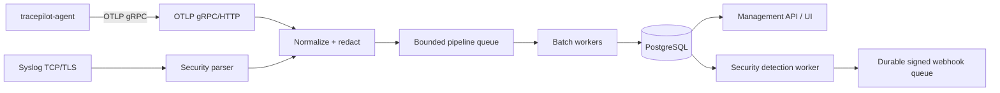

# Kiến trúc TracePilot

Tài liệu này mô tả cấu trúc đang được thực thi trong source. Quy tắc chính là
`cmd` chỉ khởi tạo ứng dụng, `internal/domain` giữ mô hình nghiệp vụ thuần,
còn I/O được đẩy ra các adapter trong `ingest`, `storage` và `transport`.

## Cây thư mục

```text
backend/
├── cmd/
│   ├── tracepilot/          # binary server: serve, migrate, mockdata, ...
│   └── tracepilot-agent/    # binary tail file và export OTLP
├── db/
│   ├── migrations/          # SQL migration, hiện tại version 13
│   └── queries/             # nguồn SQL cho sqlc
└── internal/
    ├── agent/               # tailer, batch, disk spool, checkpoint, exporter
    ├── architecture/        # test giữ dependency direction
    ├── auth/                # principal, scope và API-key policy
    ├── config/              # default, YAML, env override, validation
    ├── domain/
    │   ├── incident/        # fingerprint và trạng thái incident
    │   ├── replay/          # mô hình replay nghiệp vụ
    │   ├── security/        # event/rule/detection domain
    │   ├── telemetry/       # canonical event, span, log, metric và attributes
    │   └── ...              # domain không biết DB, HTTP hay config
    ├── ingest/
    │   ├── otlp/            # OTLP gRPC/HTTP decode, normalize, auth
    │   ├── pipeline/        # queue giới hạn byte, batch worker, ack
    │   └── syslog/          # TCP/TLS newline receiver
    ├── observability/metrics/ # Prometheus registry và runtime metrics
    ├── query/               # filter, cursor, pagination dùng chung
    ├── replay/              # allowlist, executor, service và capture
    ├── retention/           # job xóa dữ liệu hết hạn
    ├── security/
    │   ├── parser/          # CEF, LEEF, Syslog, JSON
    │   └── detect/           # evaluator bất đồng bộ và checkpoint
    ├── storage/
    │   ├── migrations/      # kiểm tra schema trước khi serve (version 13)
    │   └── postgres/         # pool, adapter, writers và sqlc-generated code
    ├── transport/httpapi/   # management API, auth middleware, OpenAPI, UI
    └── webui/               # static UI được go:embed
```

`internal` ngăn package bên ngoài module import trực tiếp implementation. Mỗi
package nên expose interface nhỏ ở biên cần mock; không tạo service container
hoặc abstraction nếu một hàm/adapter đơn giản đã đủ.

## Luồng runtime



## Điểm vào và hàm chính

| Thành phần | Điểm vào | Trách nhiệm |
| --- | --- | --- |
| Server | `cmd/tracepilot/main.go:run` | Chọn `serve`, `migrate`, `mockdata`, `healthcheck`, `version` |
| Composition root | `cmd/tracepilot/serve.go:runServer` | Load config, kiểm tra schema, nối DB/pipeline/listener/worker và graceful shutdown |
| OTLP | `ingest/otlp.NewServer` | HTTP/gRPC decode, auth, normalize và chuyển sang pipeline |
| Trace/log pipeline | `pipeline.Pipeline.Submit` | Admission theo record/byte, batch, retry và ACK sau commit |
| Metrics pipeline | `pipeline.MetricsPipeline.SubmitMetrics` | Queue best-effort tách khỏi trace/log |
| Persistence | `postgres.Database.StoreEvents` | Ghi canonical event và signal liên quan trong một transaction |
| Detection | `postgres.Database.EvaluateSecurityRules` | Lock scope, đọc checkpoint, match rule và tạo detection/incident |
| Webhook | `notification.Service.Run` | Claim outbox, ký HMAC, kiểm tra SSRF và retry |
| API | `httpapi.Server.Run` | Health, metrics, OpenAPI, API có scope và UI nhúng |

## Contract v1

- Trace/log OTLP chỉ được ACK sau khi PostgreSQL commit; queue saturation hoặc
  DB outage trả lỗi retryable. PostgreSQL là durability boundary.
- Metrics là extension best-effort và có thể drop khi backpressure/storage lỗi.
- Direct Syslog không có application ACK; sender cần disk queue nếu yêu cầu
  lossless. Agent chỉ xóa spool sau response thành công.
- Một deployment v1 dùng một ingestion project/environment. Mọi API query và
  mutation đều áp scope project từ API key; quản trị multi-project để sau v1.
- API tương thích trong `/api/v1`: thay đổi additive được phép, breaking change
  cần version mới. Error dùng envelope `code`, `message`, `request_id`.
- Webhook chỉ nhận HTTPS public, secret mã hóa AES-256-GCM và payload được ký
  HMAC-SHA256. Ý định delivery được ghi cùng transaction nghiệp vụ.

### Ingestion và durability

1. Receiver kiểm tra kích thước request/record, decode và chuẩn hóa về
   `domain/telemetry.Event`.
2. `ingest/pipeline` giới hạn đồng thời theo số record, số byte, timeout enqueue
   và batch timeout. `Submit` chỉ trả thành công sau khi batch đã được persist
   (ack sau transaction), vì vậy caller không được hiểu `accepted` là chỉ mới
   vào RAM.
3. `storage/postgres` ghi canonical events cùng các bảng span/log/security trong
   transaction. Migration phải ở version hiện tại trước khi server khởi động.
4. Khi exporter của agent không tới được server, agent ghi disk spool bounded
   (nếu cấu hình), rồi chỉ tiến checkpoint qua boundary đã export hoặc đã spool.

### Server và các listener

- Management HTTP mặc định `:8080`: health, metrics, OpenAPI, UI và API v1.
- OTLP gRPC mặc định `:4317`; OTLP HTTP mặc định `:4318` với
  `POST /v1/traces` và `POST /v1/logs`.
- Syslog là tùy chọn, mặc định tắt; khi bật dùng TCP newline trên địa chỉ
  `security.syslog_address` (Compose dev/prod cấu hình `:6514`). Production
  bắt buộc TLS và CA client (`security.syslog_client_ca_file`) để verify mTLS;
  SAN/URI/CN của client trở thành source identity, còn peer address vẫn được
  giữ làm evidence mạng.
- `cmd/tracepilot/serve` khởi tạo DB, scope, bootstrap key, pipeline, listener,
  detection và retention; SIGINT/SIGTERM đi qua graceful shutdown với
  `shutdown_timeout`.

### Management API

Danh sách route được khai báo một lần trong
`internal/transport/httpapi/routes.go`. Cùng manifest này được dùng để đăng ký
`http.ServeMux` và sinh `/openapi.json`, tránh route chạy thật lệch tài liệu.
Middleware theo thứ tự trong `server.go` xử lý request ID, metrics, rate limit,
access log, CORS, panic recovery và body limit. API key được kiểm tra scope ở
handler/middleware; replay chỉ được đăng ký khi replay service được bật.

Webhook management dùng scope `admin`. Secret được sinh hoặc nhận lúc tạo,
mã hóa AES-256-GCM trước khi ghi PostgreSQL và chỉ trả đúng một lần ở response
tạo/rotate. Retry worker lease bằng `FOR UPDATE SKIP LOCKED`, reset lease cũ sau
crash, chặn DNS/private-network ở thời điểm connect, không follow redirect và
thử lại tối đa theo `max_attempts` của delivery.

## Dependency direction

Architecture test trong `internal/architecture/dependencies_test.go` bảo vệ các
quy tắc sau:

- `domain/*` không import `config`, `storage` hoặc `transport`.
- `transport` và `ingest` không import implementation `storage/postgres`.
- `storage/postgres` không import `replay`.
- Wiring phụ thuộc concrete adapter chỉ nằm ở `cmd/tracepilot`.

Nếu thêm package mới, ưu tiên truyền interface/function từ composition root thay
vì import ngược tầng. Chạy `go -C backend test ./internal/architecture` sau mọi
thay đổi package boundary.

## SQL, migration và generated code

- Thêm schema bằng file mới trong `backend/db/migrations` với số tăng dần.
- Cập nhật query trong `backend/db/queries`, sau đó chạy sqlc version được pin
  trong Makefile (`sqlc/sqlc:1.31.1`).
- Commit cả output trong `internal/storage/postgres/sqlc`; CI chạy `sqlc-check`
  để phát hiện generated code lệch source SQL.
- Không sửa tay file generated nếu thay đổi có thể biểu diễn trong query/schema.

## Quy trình thêm tính năng

1. Xác định model/rule thuần trong `internal/domain` và test table-driven.
2. Đặt parsing/transport ở `ingest` hoặc `transport`, không đưa SQL vào domain.
3. Thêm query + migration (nếu cần), regenerate sqlc.
4. Nối dependency tại `cmd/tracepilot/serve.go`.
5. Cập nhật route manifest/OpenAPI, metrics và tài liệu nếu là API hoặc runtime
   behavior.
6. Chạy các gate trong [DEVELOPMENT.md](DEVELOPMENT.md), tối thiểu format,
   unit test, race test, vet và architecture test; cập nhật
   [ROADMAP.md](ROADMAP.md) nếu hoàn thành hoặc phát hiện blocker mới.
