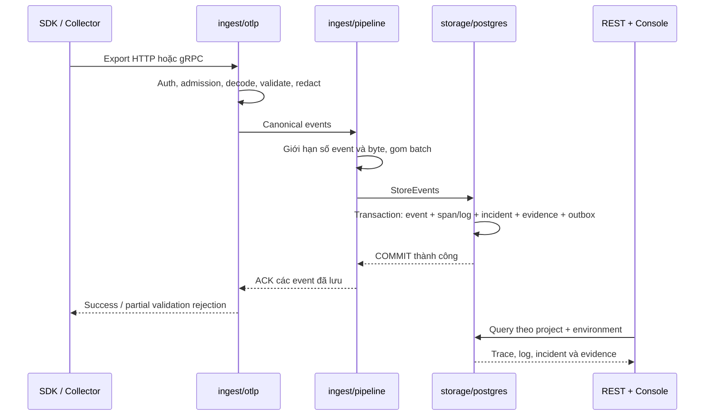

# Kiến trúc và flow TracePilot

Đối chiếu working tree ngày 13/10/2026. Hướng đã chọn: một ứng dụng Go,
React embed vào binary và PostgreSQL riêng. Trạng thái kiểm chứng ở
[REVIEW.md](REVIEW.md); điều kiện triển khai ở [OPERATIONS.md](OPERATIONS.md).

## Source theo trách nhiệm

```text
backend/
  cmd/tracepilot/             CLI, startup, wiring, shutdown, lịch partition
  internal/
    application/
      incident/              Use case đổi trạng thái và validation actor
      intelligence/          Lịch detector, ngoài đường ACK
      notification/          Webhook delivery, HMAC, outbound policy
      replay/                Replay use case, executor, allowlist, capture
      retention/             Lịch và vòng lặp dọn dữ liệu hết hạn
    domain/
      telemetry/             Event, metric và định danh ổn định
      incident/              Candidate, fingerprint, status transition
      analysis/              Evidence, detection policy và RCA ranking
      notification/          Webhook model và secret encryption
      replay/                Execution/result model
    ingest/otlp/             OTLP HTTP/gRPC, auth, decode, normalize
    ingest/pipeline/         Admission, batching, byte budget, ACK/drain
    transport/httpapi/      REST, middleware, query parsing, OpenAPI
    storage/postgres/       Database: pool, lifecycle, ghép các store bên dưới
      signals/              Ghi event + span/log (cùng incident) và metric point
      incidents/            Occurrence trong transaction ingest, đổi trạng thái, đọc incident
      outbox/               Xếp webhook delivery trong transaction, worker claim
      webhooks/             Đăng ký webhook, secret mã hóa, lịch sử delivery
      apikeys/              Cấp/rotate/revoke key, xác thực theo hash
      replays/              Lưu replay execution
      explorer/             Đọc trace, log, request performance
      analytics/            Service, topology, metric series, detection, đầu vào RCA
      maintenance/          Tạo partition theo ngày, xóa dữ liệu hết hạn
      pgvalue/              Giá trị tùy chọn → NULL, JSON, phân loại lỗi PostgreSQL
      pgbatch/              Xếp query :exec sinh bởi sqlc vào một pgx.Batch
      sqlc/                 Code sinh bởi SQLC (không sửa tay)
    storage/migrations/     Kiểm tra và chạy version schema
    auth/                   Principal, scopes và API key model
    query/                  Contract truy vấn không phụ thuộc PostgreSQL
    observability/metrics/  Prometheus cho chính TracePilot
    webui/                  Embedded assets và SPA fallback
  db/migrations/            Migration theo version (golang-migrate)
  db/queries/               Toàn bộ SQL của storage, một file mỗi chức năng
frontend/src/
  app/                      Router, auth, application shell
  features/                 Giao diện theo chức năng
  shared/                   API client, query helper, UI, types dùng chung
compose.yaml                Compose duy nhất, local PostgreSQL qua profile
.env / .env.example         Config thực / mẫu duy nhất ở root
```

Replay/notification/intelligence/retention được gom vào application để người
đọc tìm nơi điều phối trong một cây thống nhất. Interface nhỏ nằm gần consumer;
PostgreSQL triển khai chúng, cmd nối dependency. Di chuyển package giữ nguyên
API và schema.

Domain không import application, auth, config, ingest, query, metrics hoặc
adapter. Application không import config, ingest, storage, HTTP transport hoặc
webui. Transport và ingest không import storage; storage không import
application. [Architecture test](../backend/internal/architecture/dependencies_test.go)
kiểm tra các ranh giới này, kể cả subpackage.

Mỗi chức năng storage là một package có store riêng dùng chung pool.
`postgres.Database` nhúng các store nên method được promote: cmd và transport
chỉ phụ thuộc một kiểu, không đổi khi thêm store. Store chỉ import store khác khi
phải chạy trong transaction của nó, qua đúng ba hàm export nhận `pgx.Tx`:
`incidents.RecordOccurrences`/`RecordOccurrence` (signals, analytics gọi) và
`outbox.EnqueueDeliveries` (incidents, analytics gọi). Không store nào import
`postgres` gốc. [Storage test](../backend/internal/architecture/storage_test.go)
giữ danh sách phụ thuộc cho phép; thêm package mới phải khai báo ở đó.
Integration test của storage nằm ở package gốc vì chúng kiểm tra `Database` đã
ghép và cần cùng fixture project/environment.

SQL nằm trong `backend/db/queries/*.sql`; sqlc kiểm tra từng câu với schema
migration và sinh hàm có kiểu (ID là `string`, thời gian là `time.Time`, cột
nullable là con trỏ). Store chỉ gọi hàm sinh ra; transaction dùng
`pgx.BeginFunc` + `queries.WithTx`. Đường ghi nhiều dòng (ingest, occurrence)
xếp các lệnh `:exec` vào `pgbatch.Queue` rồi gửi một lần, nên vẫn một round trip
như khi viết batch tay. Filter tùy chọn dùng `sqlc.narg`: NULL nghĩa là không lọc.
Ngoại lệ được liệt kê trong [storage SQL test](../backend/internal/architecture/storage_sql_test.go):
kiểm tra `schema_migrations` (bảng của golang-migrate), DDL partition và xóa ở
default partition (tên bảng không thể là tham số, được quote bằng
`pgx.Identifier`) và savepoint. Test chặn mọi chuỗi SQL khác trong Go.
Định danh dependency (database/queue/external) là ba hàm SQL `IMMUTABLE` ở
migration 000002, dùng chung cho topology và detection; planner inline chúng.

`GET /traces/{id}` trả span theo trang (tối đa 500 span và 8 MiB mỗi trang, keyset
theo `started_at, event_id`); `next_cursor` có mặt khi còn span, nên client luôn biết
trace chưa đủ. Console đọc tối đa 5.000 span rồi báo trace bị cắt thay vì hiển thị
như đầy đủ. Mọi request API chạy dưới deadline (20s → 504) và giữ một trong 4 slot
truy vấn (`admitQuery`; hết slot → 503 + Retry-After), để đọc nặng không chiếm hết
pool của ingest và worker. Địa chỉ client cho rate limit là peer TCP; `X-Forwarded-For`
chỉ được đọc (từ phải sang) khi peer nằm trong `http.trusted_proxies`.

REST khai báo mọi route ở một bảng trong `httpapi/routes.go` (path, method,
scope); router và OpenAPI cùng sinh từ bảng đó. Router xác thực key theo scope
của route rồi mới gọi handler với `auth.Principal`, nên handler không tự kiểm
quyền và không thể lệch khỏi OpenAPI; `routes_test.go` kiểm mọi route trả 401/403
trước khi handler chạy. Handler dùng chung `writeInternalError` (ghi log, trả 500
không lộ chi tiết), `writeInvalidQuery`, `writeNotFound`, `writePage`; danh sách
con của incident đi qua `writeIncidentPage`.

Transaction và query liên quan vẫn ở PostgreSQL; replay executor và webhook
HTTP client nằm cùng workflow sở hữu chúng. Chỉ thêm use case khi cần điều phối
thật, không bọc mọi query bằng một service chuyển tiếp. Một tiến trình giữ
deploy đơn giản khi chưa có số đo cần scale riêng ingest/API/worker.

## Khởi động

[serve.go](../backend/cmd/tracepilot/serve.go) đọc config, kiểm tra schema đúng
version 2 và không dirty, mở pool, tạo partition, ingestion scope và bootstrap
key. [wiring.go](../backend/cmd/tracepilot/wiring.go) nối dependency, rồi khởi
động hai pipeline, management HTTP, OTLP và các background workflow.
Serve không tự migrate; operator chạy migrate ở bước riêng.

Config ưu tiên: process environment → file .env đầu tiên ở thư mục chạy hoặc
thư mục cha → YAML → defaults. Config sai làm startup thất bại.
Trong repo chỉ dùng .env ở root; go -C backend đọc ../.env khi backend/.env
không tồn tại. Compose dùng env_file: .env để chuyển toàn bộ giá trị thành
environment trong container; không mount file secret vào image. Không tạo
thêm backend/.env hoặc deploy/.env. File YAML vẫn là tùy chọn CLI tương thích,
không cần để chạy cấu hình chuẩn của repo.
Một server có một ingestion project/environment từ cấu hình. Read API lấy
project từ principal và environment từ server, không tin scope client gửi lên.

## Trace/log: vì sao ACK sau commit



HTTP auth và lấy slot trước khi đọc body; giới hạn cả body nén và sau giải nén.
gRPC giới hạn message nhưng decode trước handler, nên slot trong handler không
giới hạn toàn bộ bộ nhớ decode gRPC. Normalizer chuyển protocol model thành
domain model, giữ correlation và redact attribute key nhạy cảm.
Free-text log/exception/URL vẫn cần policy ở SDK/Collector; key redaction không
bảo đảm lọc mọi secret trong nội dung.

Trace/log chờ transaction commit. Auth DB, queue hoặc storage tạm lỗi trả HTTP
503/Retry-After hoặc gRPC Unavailable để exporter retry. Record sai validation
được báo partial success sau khi phần hợp lệ đã lưu. Định danh ổn định và unique
constraint ngăn retry tạo bản ghi trùng; không phải cam kết exactly-once toàn hệ thống.

Text chứa ký tự NUL bị normalizer từ chối từng record, vì PostgreSQL text/jsonb
không lưu được U+0000. Nếu PostgreSQL vẫn từ chối nội dung (SQLSTATE lớp 22,
23502, 23514), storage gắn `telemetry.ErrInvalidEvent`; pipeline không retry lỗi
này mà chia đôi batch tới khi tách được event hỏng, phần còn lại vẫn commit.
Event hỏng được báo partial success (metric rejected reason=invalid), không 503,
nên một record xấu không làm hỏng các request khác cùng batch.

Incident từ lỗi trực tiếp được tạo cùng transaction ingest. Fingerprint gồm
service, operation, error type, HTTP status và message đã chuẩn hóa: UUID, thời
điểm, email, IP, hex và số được thay bằng placeholder, nên "user 1 not found"
và "user 2 not found" là một incident. Event trong batch được gom theo
fingerprint: mỗi fingerprint một advisory lock (khóa theo thứ tự sắp xếp để hai
worker không deadlock), một lượt ghi incident và một `pgx.Batch` cho
occurrence/evidence. Occurrence chống trùng theo event, kể cả event lặp trong
cùng batch. Webhook chỉ được thêm vào outbox trong transaction; gửi mạng diễn ra sau đó.

## Metrics, detection và RCA

OTLP metrics đi qua queue riêng nhưng ACK sau commit như trace/log:
`MetricsPipeline.SubmitMetrics` chờ batch của request được ghi. Lỗi DB trả
503/Unavailable (rejected reason=storage) để exporter gửi lại; ghi idempotent nên
gửi lại không nhân đôi. Điểm PostgreSQL từ chối vì nội dung được tách khỏi các
request cùng batch và báo partial success. Admission vẫn không chặn: queue đầy là
503 ngay (reason queue_full/queue_bytes). Giữ reservation tới khi ghi xong/thất
bại; histogram +Inf tính bằng kích thước bucket để tránh lỗi JSON khi ước lượng.
Không có cam kết exactly-once: commit không rõ kết quả được gửi lại và chống trùng
bằng ID tất định. Chỉ metrics Prometheus của chính TracePilot nằm trong bộ nhớ.

Cùng queue_max_bytes áp dụng RIÊNG cho mỗi pipeline: mặc định events 64 MiB và
metrics 64 MiB. Đây không phải giới hạn tổng RSS; decoded request, map overhead,
DB buffers và UI/runtime còn dùng bộ nhớ khác.

Worker intelligence chạy mỗi phút, so cửa sổ gần nhất 5 phút với baseline
30 phút trước đó. SQL lấy signal; policy thuần ở domain/analysis quyết định
deviation. Detector ghi incident/evidence riêng, không chặn ACK telemetry.
Read analysis lấy evidence và dependency rồi gọi BuildRCA xếp hạng giả thuyết.
RCA có evidence nhưng không phải xác suất hoặc kết luận chắc chắn về nguyên nhân.
Chưa có LLM hoặc tự remediation.

Console gọi REST qua shared/api.ts và React Query. Mỗi feature sở hữu giao diện
của mình. Vite build vào internal/webui/dist; Go embed để image không cần một
web server thứ hai.

## Partition, retention và shutdown

Events/spans/logs/metric_data_points partition theo ngày UTC. Startup tạo
10 ngày bắt đầu từ hôm qua; maintenance mỗi giờ. Record ngoài cửa sổ hoặc ngày
đã có dữ liệu trong default tiếp tục vào default. Chỉ lỗi check constraint dự
kiến khi tạo partition được bỏ qua; lỗi quyền/disk/connection phải trả về.
Không tự chuyển dữ liệu default sang partition mới.

`retention.Run` dọn bốn nhóm, mỗi nhóm một max_age và timeout riêng, lỗi một nhóm
không dừng nhóm khác: telemetry (7 ngày; partition hết cả ngày được drop, default
được DELETE theo batch), incident (90 ngày), audit key (180 ngày), webhook delivery
(30 ngày). Xóa incident kéo theo evidence, occurrence, event link, lịch sử trạng
thái và replay result qua `ON DELETE CASCADE`, nên không có orphan. Chỉ xóa incident
RESOLVED/IGNORED đã yên, và delivery đã kết thúc; dữ liệu đang xử lý không bao giờ
hết hạn. Dữ liệu trong ngày cắt có thể tồn tại thêm gần một ngày; trace mà evidence
tham chiếu có thể đã hết retention. Nhiều replica cùng dọn là an toàn: DELETE theo
batch idempotent. Retention không giới hạn tổng kích thước DB.

Khi dừng: listeners ngừng nhận và chờ request trong budget, sau đó pipeline
drain trong budget tiếp theo. Default shutdown_timeout=15s, Compose stop grace=35s.
Tăng grace nếu tăng timeout. Exporter retry khi tiến trình bị kill trước ACK.
Readiness kiểm tra pipeline, OTLP runtime và DB; liveness kiểm tra tiến trình.

## Schema hiện hành

Schema gồm 000001_init (baseline) và 000002_dependency_functions (ba hàm
định danh dependency); CurrentVersion=2. Server từ chối DB khác version, nên
deploy bản này cần chạy `migrate up` trước. 000002 chỉ thêm hàm, không đổi
bảng; `migrate down 1` gỡ hàm và giữ nguyên dữ liệu. Baseline đã gộp từ lịch
sử cũ; không phải đường nâng cấp DB version 15. Không recreate DB có dữ liệu để
chạy source mới. Nếu có DB cũ, cần data migration hoặc binary tương thích.
