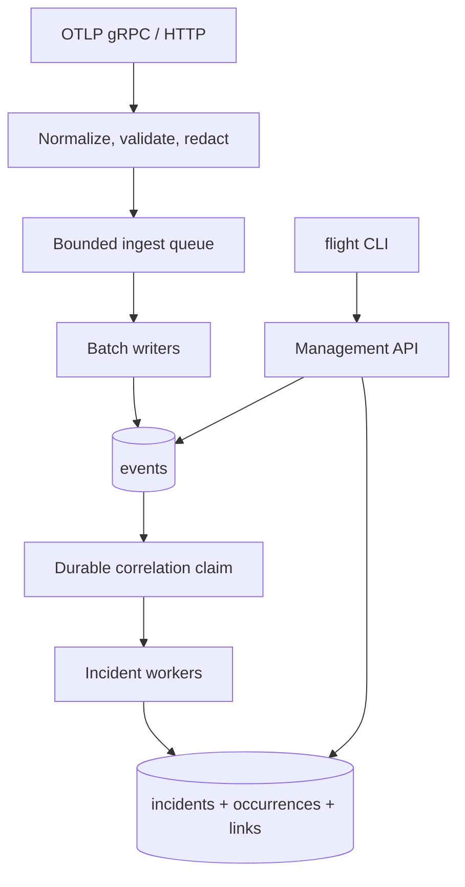
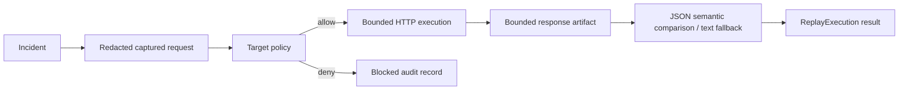

# Flight production implementation plan

Status: Phase 0, Phase 1, and Phase 2 complete and verified. Phase 3 is the next implementation target. Checkboxes describe executed evidence, not intent.

## Current assumptions

- Flight starts as one deployable Go binary and one PostgreSQL database.
- V1 accepts OTLP traces and logs; metrics are not ingested.
- An OpenTelemetry Collector is the recommended production ingress and fan-out point.
- PostgreSQL is sufficient until load tests demonstrate a concrete event-retention bottleneck.
- Request/response capture is optional and must never be required for incident detection.
- Replay targets local or staging systems. Production replay is denied by default.
- Project ID exists at every storage and API boundary, but V1 does not implement enterprise tenant isolation schemes.
- At-least-once delivery is acceptable; event IDs and occurrence constraints make retries idempotent.
- The first supported deployment is a single Flight replica. Multi-replica correctness is enabled before declaring HA support.
- The initial public API, configuration shape, and incident artifact format are versioned from their first release.

## Architecture

Flight is a modular monolith with two workload lanes:



The ingestion lane acknowledges only after the configured durability point. V1 defaults to database-committed acknowledgement. Correlation runs after persistence and is recoverable from unprocessed event rows or a transactional work table; an in-memory-only second queue would lose incident work on restart.

The management lane has separate HTTP limits and database pool budget so a slow incident query cannot exhaust connections needed by ingestion.

## Boundaries

- `ingest/otlp` owns protobuf decoding and mapping. No OTLP type crosses into `telemetry`.
- `telemetry` owns the canonical event, validation rules, and stable string values.
- `pipeline` owns bounded queues, batching, overload policy, and lifecycle.
- `postgres` owns SQL and transaction semantics. Repository interfaces are introduced only where a domain consumer needs substitution in tests.
- `incident` (Phase 3, not yet implemented) owns detection, fingerprinting, deduplication, occurrence counting, and timeline rules.
- `httpapi` owns transport concerns, authentication middleware, request IDs, pagination, and error envelopes.
- `capture` owns bounded body capture and redaction. It does not perform replay.
- `blob` owns opaque artifact keys and filesystem access.
- `replay` owns target policy, sanitized request construction, execution, audit, and comparison orchestration.

These packages are created in the phase that first uses them; the current tree intentionally contains only executable capabilities.

## Repository structure

```text
cmd/flight/              single binary and subcommand dispatch
internal/config/         validated configuration
internal/httpapi/        server lifecycle and HTTP transport
internal/telemetry/      canonical events
internal/incident/       Phase 3 detection/fingerprinting, then incident service
internal/ingest/otlp/    Phase 2 OTLP adapters
internal/pipeline/       Phase 2 bounded batch pipeline
internal/postgres/       Phase 1 pgx pool and schema readiness
internal/migrations/     Phase 1 explicit migration runner
internal/metrics/        Phase 1 Prometheus self-observability
internal/auth/           Phase 4 API-key verification
internal/capture/        Phase 5 bounded capture/redaction
internal/blob/           Phase 5 filesystem artifact storage
internal/replay/         Phase 6 policy and executor
migrations/              explicit SQL migrations
examples/demo-service/   Phase 2/3 end-to-end producer
docs/adr/                accepted architecture decisions
```

There is no `utils`, `common`, generic repository, dependency injection container, or package per database table.

## Domain model

### Event

`Event` is immutable after validation/redaction and contains identity, project/environment, service metadata, correlation identifiers, type, time/duration, severity/status, operation, error fields, bounded attributes, and an optional opaque payload reference.

String event types are stable persistence values. Unknown types normalize to `CUSTOM` with the original semantic type retained in a bounded attribute; adding a type does not require recompiling unrelated consumers.

### Incident

An incident is a grouping of equivalent failures within a configured deduplication window. It stores the latest summary and occurrence count; individual occurrences retain failure evidence. Related trace/request events build the timeline without copying event bodies.

State transitions:

```text
OPEN -> INVESTIGATING -> RESOLVED
  |           |             |
  +-----------+-----------> IGNORED
RESOLVED --new matching occurrence after policy--> OPEN or a new incident
```

V1 severity values are `INFO`, `WARNING`, `ERROR`, and `CRITICAL`; status values are stable strings. Transition validation lives in the domain service, not HTTP handlers.

### Replay execution

A replay execution is an immutable audit record plus mutable lifecycle fields while running: queued, running, succeeded, failed, blocked, or cancelled. It references redacted artifacts; it never embeds reusable production secrets.

## Database model

The initial migration contains:

| Table | Responsibility |
|---|---|
| `projects` | Primary ownership boundary |
| `environments` | Named project environment |
| `services` | Service catalog per environment |
| `events` | Canonical bounded telemetry metadata |
| `incidents` | Current incident aggregate summary |
| `incident_occurrences` | Every detected failure occurrence |
| `incident_events` | Correlated timeline membership |
| `payload_artifacts` | Metadata and opaque blob key only |
| `replay_executions` | Replay audit and outcome |
| `api_keys` | Hashed key material and scopes |

All exposed IDs are application-generated UUIDv7. PostgreSQL `uuid` columns avoid string ambiguity. Human display IDs use a presentation prefix such as `INC-` without storing a second identity.

Important indexes map to known queries: incident browse/filter, active fingerprint lookup, trace/request correlation, service/time event search, log search, occurrence history, and replay history. JSONB is limited to dynamic telemetry attributes and comparison output; ownership, filters, lifecycle, and time remain typed columns.

### Deduplication transaction

For each candidate, a transaction obtains a transaction-scoped PostgreSQL advisory lock derived from `(project_id, environment_id, fingerprint)`, selects the newest matching incident inside the dedup window, and either:

1. atomically increments `occurrence_count`, advances `last_seen_at`, and inserts the occurrence; or
2. inserts a new incident and its first occurrence.

The advisory lock is the cross-replica serialization owner. A unique active-fingerprint index is intentionally not used because it would incorrectly merge failures outside the time window. Integration tests run concurrent duplicates and assert one incident plus N occurrences.

## API contract

Base path: `/api/v1`. JSON only for management V1.

| Method | Path | Scope | Phase |
|---|---|---|---|
| `GET` | `/health/live` | public/policy | implemented |
| `GET` | `/health/ready` | public/policy | implemented |
| `GET` | `/api/v1/projects` | read | 4 |
| `GET` | `/api/v1/services` | read | 4 |
| `GET` | `/api/v1/incidents` | read | 3/4 |
| `GET` | `/api/v1/incidents/{id}` | read | 3/4 |
| `GET` | `/api/v1/incidents/{id}/events` | read | 3/4 |
| `GET` | `/api/v1/incidents/{id}/occurrences` | read | 3/4 |
| `POST` | `/api/v1/incidents/{id}/replays` | replay | 6 |
| `GET` | `/api/v1/replays/{id}` | read | 6 |

Lists use opaque cursor pagination encoding `(sort timestamp, UUID)` and a server-enforced maximum page size. Filters are allowlisted. All repository queries include `project_id`. Error responses have stable machine code, safe message, and request ID. Authentication returns the same shape without revealing whether a project/resource exists.

The CLI calls the API only. It never reads PostgreSQL or blob files directly.

## OTLP ingestion flow

```text
OTLP request
  -> enforce transport and decoded-message limits
  -> authenticate/map project
  -> map Resource + Scope + Span/LogRecord to Event
  -> validate identifiers, timestamps, lengths, and attribute depth/count
  -> redact sensitive attributes before enqueue
  -> offer to bounded queue for a bounded duration
  -> batch insert with idempotent event IDs
  -> acknowledge or return OTLP partial-success/retryable status
  -> durable incident worker claims persisted events
```

Traces ship first; logs follow in the same phase if protobuf mapping and limits meet the gate. Unsupported values are counted and rejected per record rather than crashing the request. The OTLP adapter never logs raw records.

## Concurrency model

Every long-lived goroutine belongs to the application runtime. Listeners receive the root context. Batch workers use a separately owned drain context so already accepted events can finish after listener cancellation; the shutdown deadline force-cancels that context.

| Component | Bound | Overload/failure behavior |
|---|---:|---|
| OTLP decode | request byte and record limits | reject oversized request |
| Ingestion queue | configured event count and byte estimate | wait briefly, then partial-success/retryable response; count rejection |
| Batch workers | fixed worker count and DB pool budget | bounded retry with jitter, then fail batch and expose readiness/metrics |
| Correlation claims | durable DB rows, leased in batches | retry after lease expiry; idempotent links |
| Incident workers | fixed worker count | transactional retry for serialization/deadlock only |
| Replay workers | small fixed count per instance | reject/full queue; independent pool and timeout |

Shutdown order: mark readiness false, stop listeners, stop new enqueue, drain ingestion until deadline, flush batches, release durable work claims, cancel workers, close HTTP clients and DB pools, exit non-zero if the durability deadline is missed.

No request-spawned unbounded goroutines are allowed. Queue depth, rejected records, batch latency, storage errors, incident latency, and shutdown loss are metrics without high-cardinality labels.

## Incident lifecycle

1. A persisted event qualifies when HTTP server status is at least 500, type is exception, or log severity is ERROR/FATAL.
2. Fingerprinting normalizes service, route/operation, error type, and stable error message. V1 normalization is deterministic; no AI or fuzzy clustering.
3. The deduplication transaction creates or updates an incident.
4. Correlation links events by TraceID, then RequestID, then service plus a narrowly bounded time window.
5. Timeline reads order by event timestamp and ID and calculate offsets from the earliest event.
6. A new occurrence updates summary fields without deleting historical evidence.
7. User state changes are authenticated and audited.

## Replay lifecycle



The policy parses the URL, allows only HTTP/HTTPS, rejects userinfo and ambiguous hosts, resolves DNS, validates every IP, blocks link-local/loopback/private/public ranges according to explicit environment policy, pins or revalidates the connection destination, disables automatic redirects and validates each redirect manually, caps redirects, strips sensitive headers, and enforces request/response size and total timeout. Cloud metadata hostnames and IPs are always denied. Audit data never includes credentials.

## Security model

Security gates apply before feature enablement:

- **Trust boundary:** OTLP and management APIs have separate credentials and rate budgets.
- **Secrets:** API keys are random 256-bit bearer tokens shown once and stored as a SHA-256 digest; comparison is constant-time and logs include only key ID.
- **Redaction:** header names and JSON keys compare case-insensitively; configured JSON paths supplement defaults. Redaction occurs before queueing/persistence.
- **Limits:** cap compressed bytes, decoded bytes, record count, string length, attribute count/depth, body size, and replay response size. Avoid decompression bombs.
- **Isolation:** project ID comes from authenticated context, never an untrusted query/body field; repository signatures require it.
- **Blob safety:** generated UUID keys, canonical root verification, `O_EXCL`, restrictive permissions, content hash, no symlink traversal, atomic temp-file rename.
- **Replay SSRF:** deny by default, explicit allowlist, DNS/IP validation, redirect revalidation, metadata denial, separate egress policy.
- **SQL/log injection:** parameterized queries and structured logs; control characters normalized where operationally necessary.
- **Supply chain:** pinned CI actions/images, dependency review, govulncheck, SBOM and image scan before release.

See [security.md](security.md) for the threat matrix.

## Configuration strategy

Phase 1 implements versioned YAML with environment overrides. Precedence is CLI `--config` selection > environment > YAML > default. Unknown keys, multiple documents, files over 1 MiB, invalid versions, and invalid limits fail before listeners open. Secrets use environment or mounted secret injection; effective configuration is never logged.

Configuration validation checks positive limits, queue/batch relationships, DB pool budgets, writable blob location, TLS rules, and replay policy. Critical invalid configuration fails before listeners open.

## Testing strategy

- Unit: config validation, OTLP normalization, redaction, detection, fingerprinting, replay target policy, bounded payloads, JSON comparison.
- PostgreSQL integration: clean migrations up/down, repositories, concurrent deduplication, idempotent batch insert, work claiming, project isolation.
- Protocol integration: OTLP gRPC/HTTP partial success, size limits, malformed protobuf, server shutdown.
- HTTP integration: auth, filters, stable cursors, error envelope, body/header/time limits.
- End-to-end: instrumented demo error -> persisted event -> incident -> API/CLI; later capture -> safe replay -> comparison.
- Failure: PostgreSQL outage/recovery, queue saturation, worker cancellation, blob I/O failure, DNS rebinding/redirect SSRF attempts.
- Performance: benchmarks only for proven hot paths; load test events/sec, allocation rate, DB batch latency, queue saturation, and incident delay.

Each phase runs `gofmt`, `go vet ./...`, `go test ./...`, `go test -race ./...`, Staticcheck, and `go build ./...`. Integration tests use real PostgreSQL, never SQLite.

## Deployment strategy

- Build a static binary in a multi-stage image and run as non-root with a read-only root filesystem.
- Mount a dedicated writable volume only when filesystem blob storage is enabled.
- Run migrations as an explicit pre-deploy job; never from every application replica.
- Roll out schema in expand/application/contract order when compatibility spans versions.
- Liveness checks process health only. Readiness checks database and ability to accept bounded work.
- Start with one replica. Enable multiple replicas only after durable correlation claims and advisory-lock dedup tests pass.
- Provide plain Kubernetes Deployment, Service, ConfigMap, Secret reference, probes, and resource bounds after the server consumes PostgreSQL. Helm is not justified in V1.
- Back up PostgreSQL and blob storage as one logical recovery set; test restore and orphan reconciliation.

## Implementation phases

### Phase 0 — Architecture baseline (complete)

Deliverables: plan, architecture/threat documents, canonical domain model, initial schema, API contract, concurrency ownership, ADRs, repository skeleton.

Exit gate:

- [x] No speculative empty packages or fake implementations.
- [x] Server scaffold is buildable in a pinned container toolchain.
- [x] Initial domain logic has runnable unit tests.
- [x] Apache-2.0 license, private vulnerability workflow, and canonical module path are documented.
- [x] Schema passed critical review and clean `up -> down -> up` PostgreSQL validation.

### Phase 1 — Production foundation (complete)

Implemented pgx pool configuration, explicit in-binary migration command, strict YAML plus environment config, Prometheus metrics, PostgreSQL/schema-backed readiness, management API limits, and release metadata.

Exit gate evidence:

- [x] Clean migration reaches version 1 and `down 1 -> up` succeeds.
- [x] Invalid and unknown configuration fails before listening.
- [x] PostgreSQL outage keeps liveness `200` and changes readiness to `503`.
- [x] Readiness requires a reachable database and current non-dirty schema.
- [x] SIGTERM drains the HTTP server and exits `0` within deadline.
- [x] Format, Vet, unit/race tests, Staticcheck, build, Docker and metrics tests pass.

### Phase 2 — OTLP ingestion (complete)

Implemented OTLP/gRPC and OTLP/HTTP protobuf/JSON traces and logs, normalization, pre-queue redaction, bounded admission, fixed batch workers, commit-backed acknowledgement, partial-success behavior, ingestion metrics, and synthetic demo service instrumentation.

Exit gate evidence:

- [x] The instrumented demo exports a synthetic failing trace and the canonical event appears in a clean PostgreSQL database.
- [x] Trace and log protobuf normalization, sensitive-key redaction, missing identity rejection, OTLP/HTTP logs, and oversized body behavior have runnable tests.
- [x] Queue saturation returns bounded rejection and has a deterministic test.
- [x] `Submit` cannot acknowledge before its store call commits; event IDs remain stable across retries, and a real-PostgreSQL integration test proves duplicate delivery leaves one event row.
- [x] Ingestion queue depth, accepted/rejected records, batch latency, and storage failures are exported as bounded-cardinality metrics.

### Phase 3 — Incident vertical slice

Implement durable work claims, deterministic detection, advisory-lock deduplication, occurrence storage, TraceID/RequestID correlation, timeline, and incident read endpoints.

Exit gate: demo `GET /error` emits HTTP 500 -> event persists -> exactly one incident appears -> concurrent repeats increment occurrences -> `/api/v1/incidents` returns it.

### Phase 4 — Authentication, management API, and CLI

Implement API-key lifecycle/bootstrap, hashed storage, scopes, constant-time verification, project context, filters/cursors, incident detail, and CLI API client with human and JSON output.

Exit gate: unauthorized/cross-project access tests fail closed; CLI lists and gets the demo incident; pagination is stable during concurrent inserts.

### Phase 5 — Safe capture and blobs

Implement optional HTTP middleware, bounded stream-preserving body capture, default and custom redaction, content-type policy, truncation metadata, filesystem blob storage, cleanup, and artifact authorization.

Exit gate: requests continue if recorder fails; secrets never reach database/blob/log fixtures; oversized bodies are bounded; traversal and symlink tests fail closed; incident holds a safe captured request.

### Phase 6 — Replay

Implement replay policy, target allowlist, IP/DNS/redirect validation, separate HTTP transport, credential stripping, bounded worker pool, timeout/size caps, result artifact, and audit endpoint/CLI command.

Exit gate: local demo replay succeeds; production/public/metadata/redirect/DNS-rebinding fixtures are blocked; target outage is recorded without affecting ingestion.

### Phase 7 — Semantic comparison

Implement structural JSON comparison with configured ignored paths and a text fallback. Store bounded difference summaries, not duplicate bodies.

Exit gate: dynamic IDs/timestamps can be ignored; meaningful changes are reported deterministically; invalid JSON uses safe text comparison.

### Phase 8 — Production hardening and release

Run load/soak, race, fuzz, outage, migration, backup/restore, container, dependency, threat-model, and documentation reviews. Add minimal Kubernetes manifests and release automation.

Exit gate: all final validation commands and E2E paths have recorded evidence; no critical/high known security findings; rollback and restore are rehearsed; SLO/capacity guidance is documented.

## Risks and mitigations

| Risk | Consequence | Mitigation / proof |
|---|---|---|
| PostgreSQL event volume grows quickly | latency/storage exhaustion | retention policy, batching, partitioning only after measurement, ClickHouse decision trigger |
| Queue saturation | missing incidents or upstream retries | byte/record bounds, partial success, rejection metrics, capacity test |
| Dedup race across replicas | duplicate incidents/count loss | transaction advisory lock plus concurrent integration test |
| Redaction misses encoded secrets | credential persistence | default deny capture, content-type policy, layered configurable redaction, synthetic security corpus |
| Replay SSRF/DNS rebinding | internal/cloud compromise | resolved-IP policy, controlled dialer, redirect revalidation, egress firewall, adversarial tests |
| Filesystem blobs diverge from DB | orphan/missing artifacts | atomic write-before-reference protocol, hash, reconciler, joint backup/restore test |
| Correlation by time mislinks events | misleading incident | TraceID/RequestID priority, narrow window, evidence label, deterministic tests |
| OTLP data is malicious/huge | memory/CPU DoS | transport and decoded limits, bounded attributes, request rate budget, fuzzing |
| Project filter omitted | cross-project leak | project-aware repository signatures, composite FKs, isolation integration tests |
| Shutdown deadline expires | acknowledged telemetry loss | durability contract, drain metrics, forced-shutdown test, durable claims |

## Open questions requiring owner decisions

1. Publish a monitored private security contact and disclosure SLA before the first public release.
2. Define V1 retention targets, expected events/second, average attribute size, and acceptable ingestion backpressure.
3. Confirm the production durability decision that acknowledged OTLP means committed to PostgreSQL.
4. Choose the Phase 4 production project mapping: per-project ingest key, mTLS identity, or trusted Collector header. Phase 2 intentionally uses one static configured identity behind a trusted network boundary.
5. Decide whether filesystem blobs are single-replica/development only or backed by verified shared-volume semantics.
6. Define deployment network policy for replay targets; application SSRF checks are necessary but not sufficient.

## Critical architecture review and corrections

- Removed proposed `flight-proxy`, capture, replay comparator, multiple integration SDK, and generic platform packages from the initial tree; none is needed for the first vertical slice.
- Kept one `flight` binary instead of separate server and CLI binaries; subcommands share versioning and the CLI still uses only HTTP.
- Replaced an in-memory correlation queue with durable database work claiming so acknowledged events survive restart.
- Defined bounded admission and explicit partial-success behavior; memory cannot grow with incoming telemetry.
- Removed a unique “active fingerprint” constraint because it breaks time-window deduplication; cross-replica races use a transaction-scoped advisory lock.
- Kept OTLP protobuf models at the adapter boundary and a storage-neutral Event domain, allowing a future ClickHouse writer without changing detection.
- Made redaction occur before any queue/persistence and made capture disabled until its security tests pass.
- Made replay a later phase with allowlist, DNS/IP, redirect, credential, egress, size, and audit controls; arbitrary URLs are not accepted.
- Separated management, ingestion, incident, and replay resource budgets so one workload cannot trivially starve all others.
- Deferred Kafka, Redis, ClickHouse, external backend adapters, Helm, proxy, eBPF, AI, and metrics ingestion until measured requirements exist.

## Production definition of done

Flight V1 is production-ready only when all of the following are evidenced:

- A clean PostgreSQL instance migrates up; rollback/forward recovery behavior is documented.
- Demo OTLP traces/logs create persisted canonical events and one correctly deduplicated incident.
- API and CLI return the incident and stable timeline under authentication and project isolation.
- Optional captured bodies are bounded and redacted before storage; sensitive corpus tests find no leak.
- Replay succeeds against an allowed local/staging target and blocks all threat-model targets.
- Invalid config, PostgreSQL outage, blob failure, malformed OTLP, saturation, and SIGTERM have verified behavior.
- `gofmt`, `go vet`, unit/integration/E2E tests, race detector, Staticcheck, fuzz smoke tests, and build pass.
- Docker runs non-root, supports read-only root, reports correct probes, and exits within the shutdown budget.
- Load test meets the declared throughput/latency/retention envelope with documented resources.
- Dependency scan, image scan, threat-model review, backup/restore drill, and documentation review pass.
- Every unexecuted validation is reported as unverified; no inferred success is accepted.
