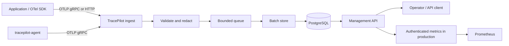
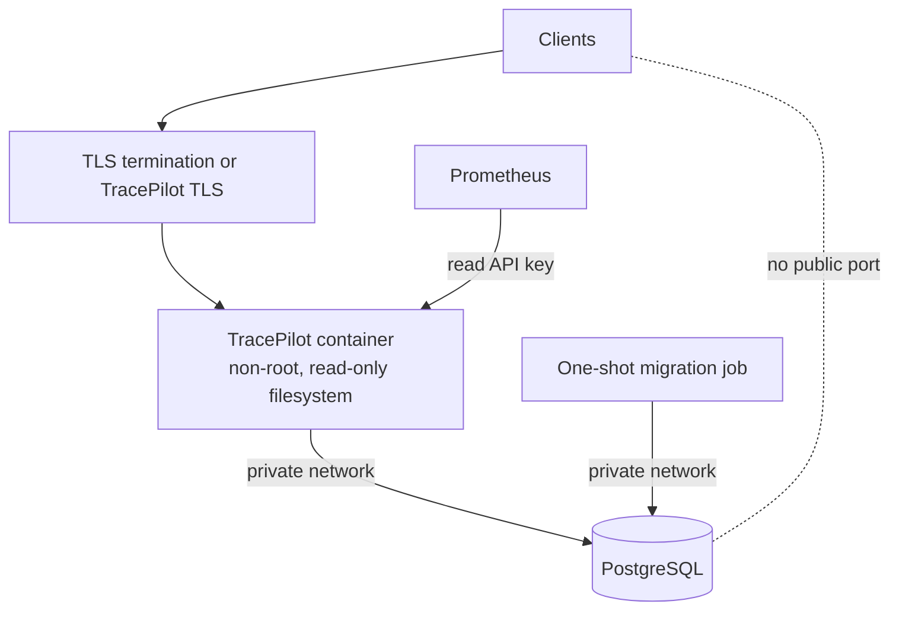
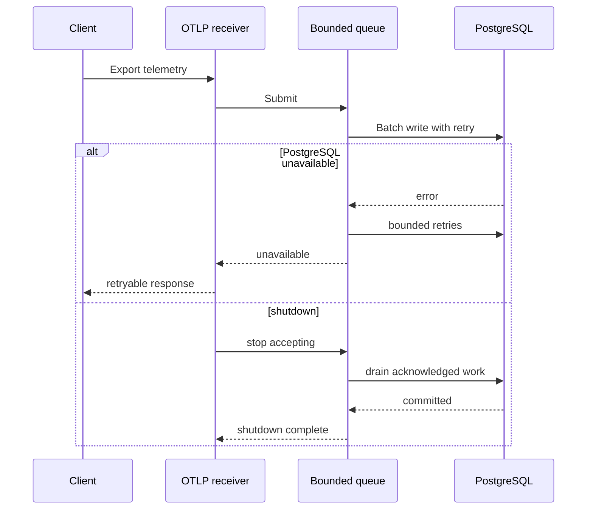

# Production readiness

Tài liệu này mô tả luồng triển khai TracePilot v1 và bằng chứng cần có trước
khi go-live. Compose ở repository là môi trường development/smoke; production
phải dùng secret manager, TLS certificate thật và PostgreSQL không public.

## Luồng runtime

## Production deployment boundary

## Shutdown and recovery

## P0 evidence

| Check | Required evidence |
| --- | --- |
| PostgreSQL outage/recovery | Pipeline retry test and disposable PostgreSQL recovery test pass. |
| Shutdown with queued work | Pipeline proves acknowledged work drains before shutdown returns. |
| Backup/restore | `pg_dump` archive restores into an empty disposable database and data is queried. |
| Migration rollback | Database runs `up → down 1 → up` and reports current schema version. |
| PostgreSQL exposure | Production Compose/manifest has no host `5432` mapping. |
| TLS SAN healthcheck | Certificate contains the healthcheck host/IP and `tracepilot healthcheck` succeeds over HTTPS. |
| CI/PR | All GitHub required checks are green on the exact branch commit. |

## Kết quả drill cục bộ — 2026-08-31

| Checkpoint | Kết quả | Bằng chứng |
| --- | --- | --- |
| PostgreSQL outage/recovery | Pass | Dừng PostgreSQL disposable làm `/health/ready` lỗi; khởi động lại database làm healthcheck pass. |
| Shutdown khi queue còn dữ liệu | Pass | `TestShutdownDrainsQueuedWork` chứng minh shutdown chờ cả hai batch đã được nhận ghi xong. |
| Retry sau outage tạm thời | Pass | `TestSubmitRecoversAfterTemporaryStoreOutage` xác nhận retry thành công sau hai lần store lỗi. |
| Backup/restore | Pass | `pg_dump -Fc` restore vào database rỗng: 10.000 events, 100 incidents, schema version 8. |
| Migration rollback | Pass | Trên fixture đại diện đã ẩn danh: `8 → 7 → 8`, sau đó vẫn còn 10.000 events, 100 incidents. |
| PostgreSQL không public | Pass (cấu hình) | `compose.production.yaml` validate và không có mapping host `5432`. |
| TLS SAN và healthcheck | Pass (logic) | Healthcheck HTTPS xác thực certificate có SAN `127.0.0.1`/`localhost`; CA nội bộ có thể truyền qua `TRACEPILOT_HEALTHCHECK_CA_FILE`. |
| Race + integration tests | Pass | Linux container + PostgreSQL disposable: `go test -race ./...`, exit code 0. |

Fixture migration là dữ liệu **đại diện và không nhạy cảm**, không phải dump production.
Trước go-live phải lặp lại drill với snapshot production đã được mask/anonymize và có
chủ sở hữu dữ liệu phê duyệt.

## Hai cổng bắt buộc còn phụ thuộc môi trường ngoài repository

1. **Deployment production:** dùng đúng manifest/Compose đã render từ secret manager
   để chứng minh PostgreSQL chỉ nằm trên private network. Source không chứa hạ tầng
   production thực nên không thể xác nhận điều này chỉ từ máy local.
2. **TLS certificate thật:** đặt `TRACEPILOT_HEALTHCHECK_URL` là HTTPS URL có host/IP
   nằm trong SAN certificate. Nếu dùng CA nội bộ, mount CA read-only và đặt
   `TRACEPILOT_HEALTHCHECK_CA_FILE=/run/tls/ca.crt`. Chạy `/tracepilot healthcheck`
   ngay trong container release.
3. **CI/PR thật:** commit đúng thay đổi, push branch và mở/cập nhật PR; tất cả jobs
   `lint`, `test`, `docker`, `smoke`, `ci-success` phải xanh trên đúng SHA. Không có
   GitHub CLI/token trong workspace này, do đó không thể push hoặc tự xác nhận check
   từ local mà không có quyền repo.
