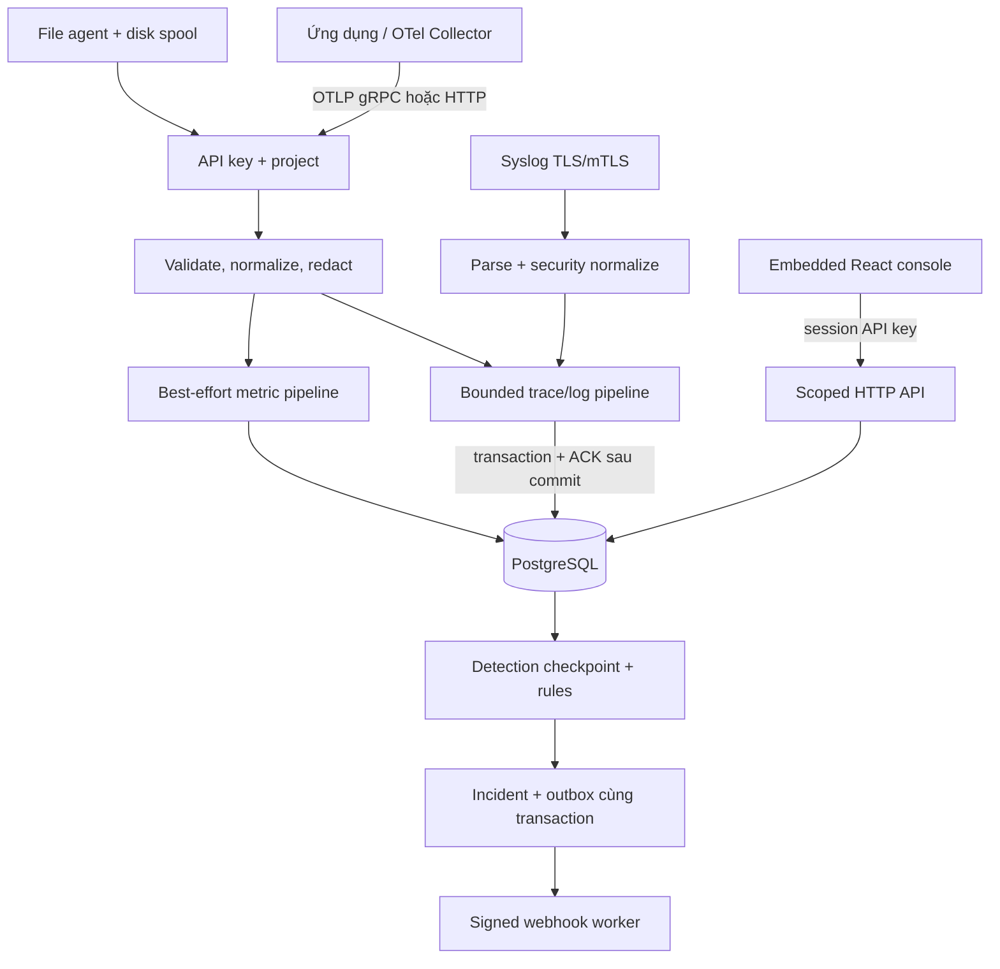

# Đánh giá source và kế hoạch refactor TracePilot

Ngày đánh giá: 2026-09-09
Phạm vi: working tree hiện tại trên nhánh `develop`, bao gồm cả file chưa commit.

## Kết luận ngắn

TracePilot có nền backend tốt hơn mức thường thấy ở một dự án `0.1`: boundary khá
rõ, đường ingest có backpressure và ACK sau commit, query có project/environment
scope, các chức năng outbound có phòng vệ SSRF, và CI bao phủ migration, race,
static analysis, image build. Đây là nền tảng đủ tốt để làm beta có người dùng.

Điểm nghẽn hiện tại không phải là cần thêm abstraction. Điểm nghẽn là phạm vi sản
phẩm quá rộng so với hành trình người dùng: trace, log, metric, incident, replay,
Syslog security, rule và webhook đã cùng tồn tại, nhưng người mới vẫn phải tự dựng
stack, tự tạo key, tự instrument ứng dụng và không có onboarding dẫn tới “trace đầu
tiên”. Nên dừng mở rộng capability, chọn một use case mũi nhọn và refactor theo
đường đi của use case đó.

Khuyến nghị cho beta đầu tiên là kiểm chứng định vị: **điều tra lỗi production bằng
trace + log tương quan, self-host trong 10 phút cho team backend nhỏ**. Security nên
giữ dưới cờ experimental cho design partner; metrics chỉ nên được mô tả là đường
ingest tương thích/best-effort cho đến khi có query và UI mang lại giá trị thật.

## Chấm điểm hiện trạng

Điểm là đánh giá heuristic trên source hiện tại, không phải chứng nhận production.

| Hạng mục | Điểm | Nhận xét |
| --- | ---: | --- |
| Kiến trúc và dependency direction | 8/10 | Domain, ingest, storage, transport và composition root tách hợp lý; có architecture test. |
| Correctness của ingest | 8/10 | Queue có giới hạn record/byte, retry hữu hạn, trace/log chỉ ACK sau transaction commit. |
| Security nền tảng | 7.5/10 | Project scope, API-key scope, redaction, TLS/mTLS, webhook encryption và SSRF defense được nghĩ kỹ; vẫn còn test matrix cần hoàn tất. |
| Maintainability | 7/10 | File nhỏ, dependency ít, tên package rõ; SQL còn phân tán và một số contract được mô hình hóa chưa đầy đủ. |
| Test và delivery | 7/10 | 153 Go test function, integration PostgreSQL và Docker build pass; frontend chỉ có 4 test case, local race chưa chạy được trên Windows. |
| Vận hành production | 6/10 | Có health, metrics, retention, runbook, drills và release signing; SLO/capacity/restore evidence chưa hoàn tất. |
| Trải nghiệm sản phẩm | 4/10 | Console đọc dữ liệu ổn nhưng thiếu onboarding, setup/admin UI, workflow end-to-end và browser E2E. |
| Sẵn sàng có người dùng thật | 3/10 | Chưa có ICP đã kiểm chứng, activation funnel, design partners, public demo và feedback loop. |

## Luồng đang được thực thi

Các boundary quan trọng:

- `cmd/tracepilot/serve.go` là composition root; đây là nơi duy nhất nên biết các
  adapter concrete.
- `internal/ingest/otlp` xác thực, normalize và chuyển dữ liệu sang pipeline.
- `internal/ingest/pipeline` sở hữu admission, batching, retry và ACK semantics.
- `internal/storage/postgres` sở hữu transaction, query và project isolation.
- `internal/transport/httpapi` sở hữu route, auth scope, pagination và response.
- `web/src` là operator console nhúng vào binary Go.

## Điểm đang làm tốt

1. **Durability contract rõ:** trace/log không trả thành công khi mới nằm trong RAM;
   transaction ghi canonical event và signal record trước khi ACK.
2. **Boundary thực dụng:** dùng interface ở biên cần test, không có service container,
   factory hoặc framework nội bộ không cần thiết.
3. **Giới hạn tài nguyên:** request, attribute, queue byte, worker, timeout và body
   đều có validation; rate limiter được giới hạn số bucket.
4. **Security có chiều sâu:** secret không lưu plaintext, webhook ký HMAC, không
   follow redirect, DNS được kiểm lại lúc dial, replay dùng allowlist.
5. **Delivery pipeline tốt:** CI có format, vet, staticcheck, vulnerability scan,
   PostgreSQL migration round-trip, integration race, Docker smoke test; release có
   checksum, SBOM, provenance và signature.
6. **Phụ thuộc gọn:** backend ưu tiên Go stdlib, pgx và protocol chính; frontend dùng
   một stack nhỏ, không có state framework thừa.

## Vấn đề ưu tiên

| Mức | Vấn đề và bằng chứng | Tác động | Quyết định đề xuất |
| --- | --- | --- | --- |
| P0 | `middleware.go` khai báo CORS methods thiếu `PUT`, trong khi `routes.go` có `PUT /api/v1/webhooks/{webhookID}`. Test preflight hiện không có case PUT. | Console/API chạy khác origin sẽ không cập nhật webhook được trên browser. | Sinh allow-methods từ route manifest hoặc ít nhất thêm `PUT`; test toàn bộ method có trong manifest. |
| P0 | Working tree có 119 path thay đổi trước khi thêm tài liệu này; toàn bộ `web/`, migration 9-13 và nhiều package mới chưa tracked, còn `SECURITY.md` và `CONTRIBUTING.md` bị xóa. | CI/release từ commit hiện tại không tái tạo sản phẩm đang được review. | Chia thành commit nhỏ theo vertical slice, chạy CI trên clean clone, khôi phục hoặc thay thế tài liệu governance trước public beta. |
| P0 | Sản phẩm đang đồng thời mở rộng observability và SIEM; metrics luôn được persist nhưng chưa có query API/UI. | Tăng schema, retention và support cost nhưng chưa tăng activation. | Chốt một wedge cho beta; đóng băng metrics/security expansion cho đến khi interview hoặc usage chứng minh nhu cầu. |
| P1 | OpenAPI dùng schema `object` rỗng cho request, không có response model và thêm một nhóm filter chung cho nhiều list operation dù handler không nhận đủ các filter đó. | SDK/client generation không đáng tin, người dùng phải đọc source. | Viết contract cho 5 endpoint thuộc happy path trước; thêm schema/fixture test, không cần dựng codegen framework. |
| P1 | Coverage khi chạy unit test là 30.3% ở HTTP và 0.9% ở PostgreSQL; integration test có pass khi bật env nhưng chưa phủ hết cross-project/cross-environment và failure path. | Rủi ro leak tenant, false ACK và regression khi refactor query. | Thêm test theo risk matrix, không đặt mục tiêu coverage phần trăm chung. |
| P1 | Frontend có 699 dòng production nhưng chỉ 37 dòng test/4 test case; chưa có browser E2E cho connect → ingest → tìm trace → mở log. | Build xanh nhưng hành trình chính vẫn có thể hỏng. | Một Playwright/Cypress smoke test chỉ hợp lý khi onboarding ổn định; trước đó thêm integration test cho 3 trạng thái loading/empty/error và mutating flows. |
| P1 | Rate limit dùng `RemoteAddr`; sau reverse proxy, nhiều người có thể chung một bucket. | Dễ rate-limit nhầm toàn bộ người dùng hoặc không phản ánh actor thật. | Rate-limit theo key ID sau auth; chỉ đọc forwarded IP khi có danh sách trusted proxy rõ ràng. |
| P1 | OpenAPI luôn công bố route replay/webhook trong khi runtime có thể disable hoặc không register. | Client thấy capability nhưng nhận 404/501 tùy cấu hình. | Trả capability/status rõ từ API và đánh dấu extension trong spec; giữ behavior nhất quán. |
| P2 | SQL ổn định nằm cả trong source Go và `db/queries`; chỉ trace/service dùng SQLC đầy đủ. | Review schema/query và regenerate dễ lệch nhau khi số query tăng. | Chuyển query ổn định, dài và nhiều cột trước; giữ SQL ngắn/dynamic ở Go nếu rõ hơn. |
| P2 | `Server` nhận một `Backend` ghép nhiều interface và `serve.go` biết nhiều subsystem. | Có thể tăng fake setup và merge conflict về sau, nhưng hiện chưa phải bottleneck. | Không tạo DI container. Chỉ tách constructor theo subsystem khi file vượt gate hoặc thay đổi gây xung đột lặp lại. |
| P2 | UI lặp ba type “query-like” và các wrapper danh sách gần giống nhau. | Maintenance nhỏ, không ảnh hưởng người dùng hiện tại. | Gom một helper/type khi sửa các màn hình đó; không mở riêng một đợt refactor. |

## Kế hoạch refactor theo vertical slice

### Giai đoạn 0 — Chốt baseline và phạm vi (1-2 ngày)

Mục tiêu: mọi người review và chạy đúng cùng một source.

1. Chọn một lời hứa beta và một primary flow. Mặc định đề xuất:
   `install → gửi OTLP trace/log → tìm trace lỗi → mở correlated log`.
2. Chia 119 path đang thay đổi thành commit: core refactor, security, metrics,
   webhook, web console, deploy/docs. Không trộn generated asset với domain change.
3. Xác nhận clean clone chạy được `npm ci`, web build, migration, Go integration
   test và Docker smoke test.
4. Gắn label experimental cho capability ngoài primary flow; không thêm capability
   mới trong các giai đoạn dưới.

Exit gate: clean clone ở commit được chọn tái tạo image và hoàn thành primary flow.

### Giai đoạn 1 — Sửa correctness và contract (2-4 ngày)

Mục tiêu: external client không phụ thuộc vào chi tiết ngầm trong source.

1. Sửa CORS PUT từ cùng một nguồn route manifest và thêm test chống lệch method.
2. Chốt 5 contract lõi: authenticate/readiness, list traces, trace detail, trace
   logs và list logs. Mỗi contract có request/filter, response schema và error mẫu.
3. Thêm matrix test project A không thể đọc/mutate project B cho mọi endpoint lõi;
   thêm environment mismatch và cursor tampering.
4. Test pipeline khi DB lỗi, queue đầy và shutdown; assert không deadlock, không
   ACK sai và goroutine kết thúc trong deadline.
5. Quyết định metrics: thêm config `experimental_metrics_enabled=false` hoặc ngừng
   persist trong beta. Chỉ xây query/UI khi có design partner dùng nó.

Exit gate: không còn lỗi P0; happy-path spec chạy được bằng curl mà không đọc code;
failure tests của durability/isolation đều xanh.

### Giai đoạn 2 — Refactor quanh activation (5-7 ngày)

Mục tiêu: người lạ thấy dữ liệu hữu ích trong dưới 10 phút.

1. Có một lệnh dev install và một đường production install ngắn, deterministic.
2. Tạo onboarding trong UI với ba bước: connect key, copy OTLP config cho một SDK,
   xác nhận signal đầu tiên; empty state phải dẫn thẳng tới bước tiếp theo.
3. Dùng một sample app/fixture nhỏ tạo một trace lỗi có correlated log. Không tạo
   demo framework riêng.
4. Giữ filter trace trong URL, làm rõ loading/empty/error/retry và sửa waterfall
   theo cây parent/child.
5. Thêm một browser smoke test cho primary flow sau khi UI ổn định.

Exit gate: 5 người chưa biết codebase tự cài được; median time-to-first-trace dưới
10 phút và ít nhất 4/5 hoàn thành mà không cần maintainer điều khiển máy.

### Giai đoạn 3 — Production trust cho beta (5-10 ngày)

Mục tiêu: design partner có thể chạy liên tục và nâng cấp an toàn.

1. Hoàn tất outage/shutdown/spool/detection checkpoint test trong `ROADMAP.md`.
2. Chạy migration round-trip, backup/restore và upgrade/rollback trên dataset beta.
3. Chốt SLO tối thiểu cho ingest commit latency, query latency và data loss; chạy
   soak ở 2 lần tải beta thay vì tối ưu theo tải giả định lớn.
4. Rate-limit theo authenticated identity; audit log không chứa secret/raw body;
   công bố security contact và supported-version policy.
5. Thêm UI/API quản trị chỉ khi design partner cần: ưu tiên API key trước webhook,
   không xây admin console tổng quát.

Exit gate: một design partner chạy 7 ngày, có backup restore được, nâng cấp và
rollback thành công, không có critical/high issue chưa có quyết định.

### Giai đoạn 4 — Refactor theo số liệu (liên tục)

Chỉ thực hiện khi profiler, query plan hoặc lịch sử thay đổi chỉ ra vấn đề:

- Chuyển SQL có churn/cột mapping cao sang SQLC; không ép toàn bộ SQL vào generator.
- Tách `serve.go` khi có subsystem được phát triển độc lập hoặc file vượt size gate.
- Partition table khi retention delete không đạt SLO trên dataset thật.
- Nhiều replica/leader election khi một replica không đạt availability/throughput.
- Tạo shared UI abstraction sau lần lặp thứ ba có cùng behavior, không chỉ giống cú
  pháp.

## Những việc chưa nên làm

- Không tách microservice, thêm message broker, DI container hoặc internal event bus.
- Không làm Kubernetes/Helm, multi-project admin, billing hoặc fine-grained RBAC
  trước khi có người dùng beta yêu cầu.
- Không xây metrics dashboard chỉ để “đủ bộ three pillars”.
- Không rewrite frontend hoặc thay framework; React hiện tại đủ cho primary flow.
- Không tối ưu query nếu chưa có `EXPLAIN ANALYZE` trên dữ liệu gần thực tế.

## Bằng chứng kiểm tra tại thời điểm review

| Kiểm tra | Kết quả |
| --- | --- |
| `go test ./...` | Pass |
| Go integration test với PostgreSQL 17 disposable | Pass |
| `go vet ./...` | Pass |
| `staticcheck 2026.1 ./...` | Pass |
| `gofmt -l` và `git diff --check` | Pass |
| `npm ci`, TypeScript check, 4 Vitest cases, Vite build | Pass; npm audit báo 0 vulnerability |
| Docker build + `version` smoke test | Pass; image chạy `nonroot:nonroot` |
| `go test -race ./...` local | Chưa chạy: Go trên Windows đang `CGO_ENABLED=0`; workflow Ubuntu đã cấu hình race + integration nhưng cần chạy trên commit/PR sạch |

Tài liệu này là thứ tự ra quyết định và refactor. Backlog kỹ thuật chi tiết tiếp tục
nằm ở `docs/ROADMAP.md`; checklist tạo người dùng thật nằm ở
`docs/REAL_USER_CHECKLIST.md`.
