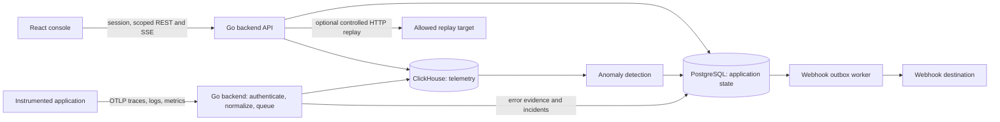
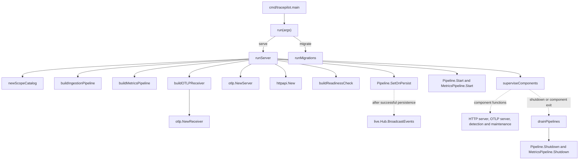
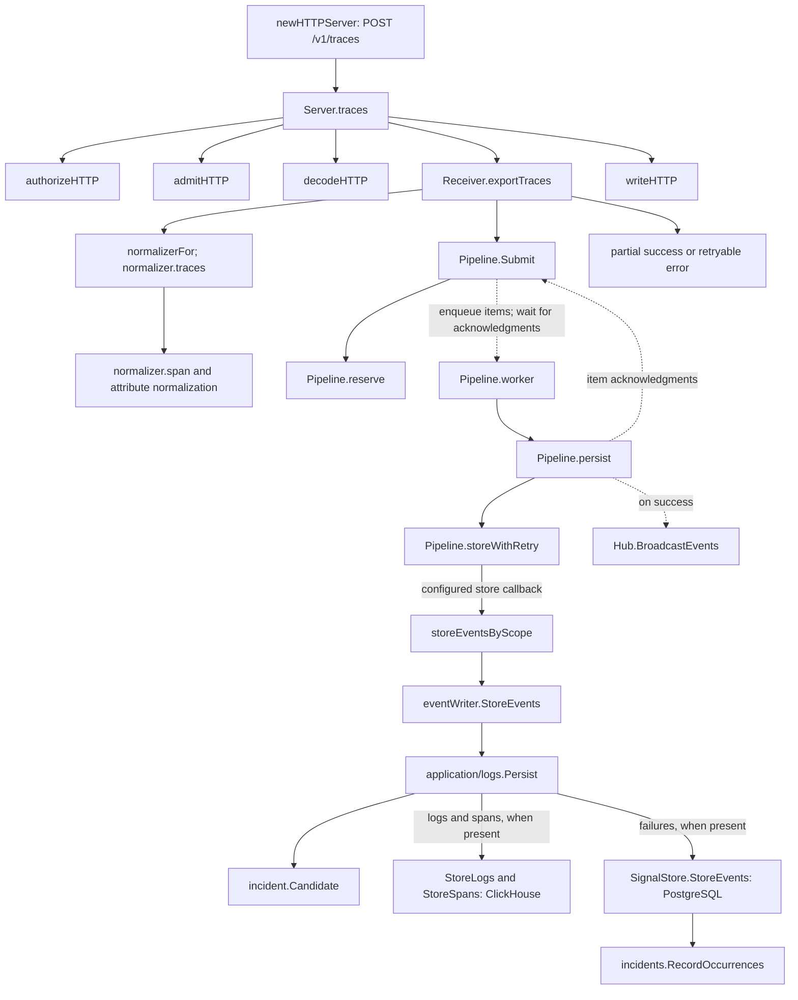
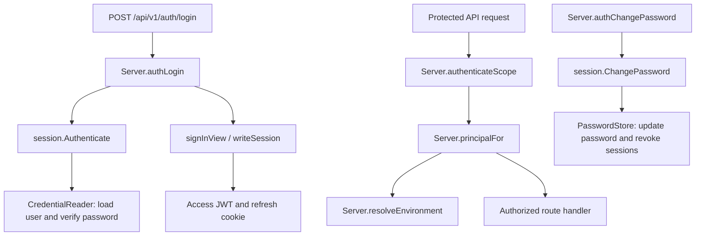
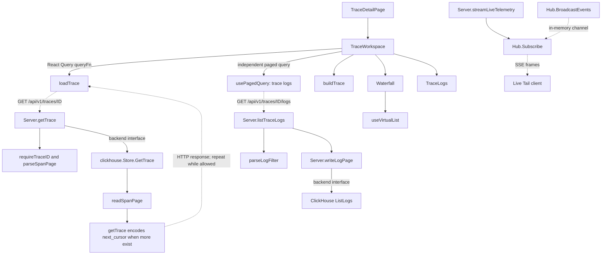
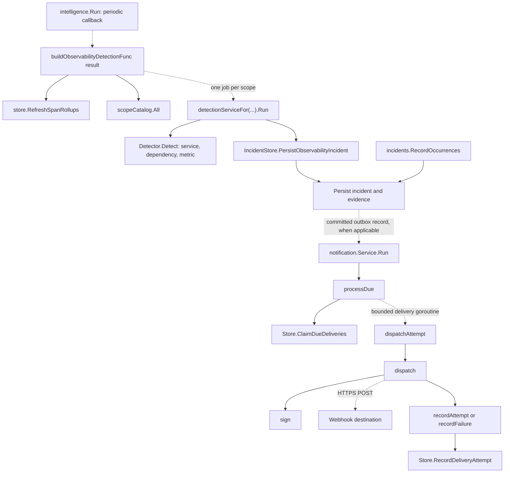
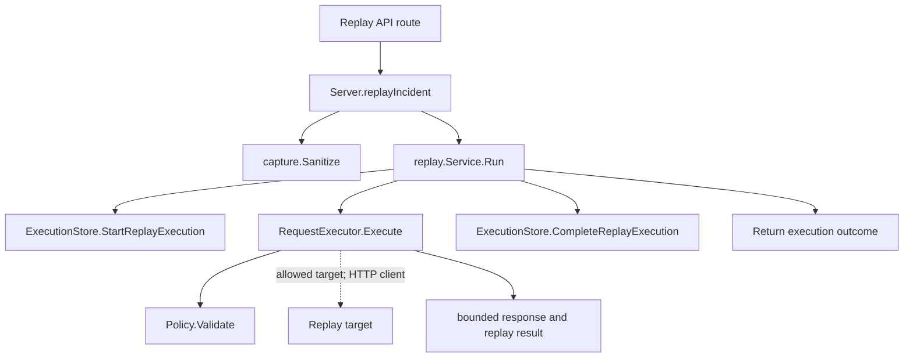
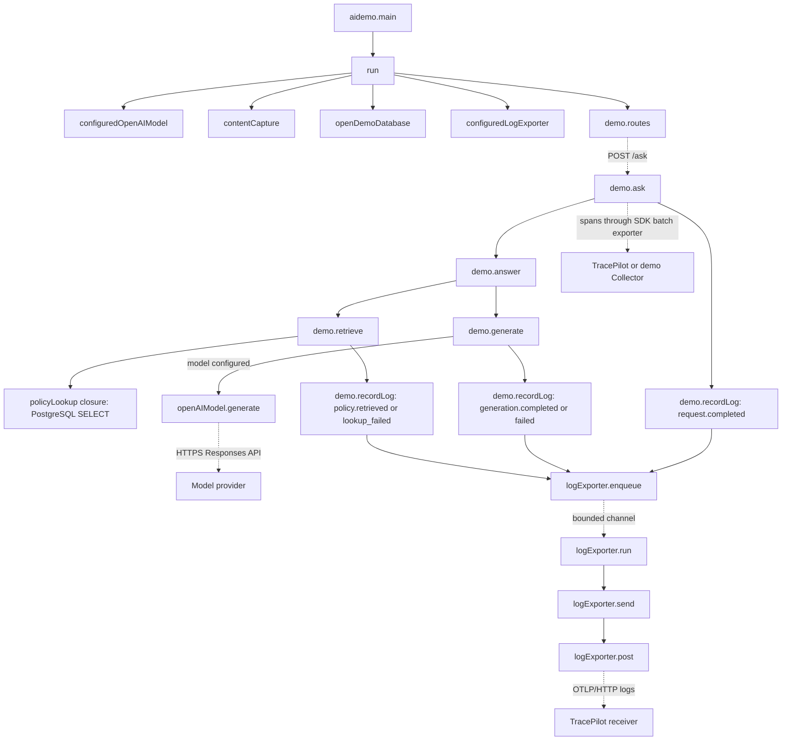
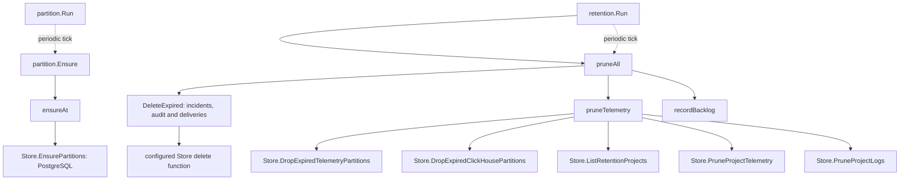

# TracePilot system flow and design trade-offs

This document explains the current implementation in this workspace: what happens, why the design is useful, and what it costs. It is a companion to [the detailed application flow](FLOW.md), [the component map](STRUCTURE.md), and [the setup and operating instructions](../README.md). Defaults and limits below are implementation choices, not capacity guarantees.

## 1. The system at a glance

The backend is one Go application with separate responsibilities in the source tree: `cmd/tracepilot` wires and starts the process; `application` coordinates use cases; `domain` holds rules; `ingest`, `transport/httpapi`, and `storage` adapt external protocols and databases. The console is a separate React application. PostgreSQL and ClickHouse are external services.

**Why:** keeping related use cases in one process avoids network contracts and operational overhead between modules. PostgreSQL is suited to transactional accounts, memberships, incidents, and delivery state; ClickHouse is used for high-volume telemetry and analytical reads. Module boundaries still give the code explicit ownership.

**Trade-off:** one backend release and failure domain contains APIs, ingestion, and workers. The two databases add deployment, monitoring, backup, and recovery work. A module boundary does not independently scale a workload; split a process only when a requirement or measurement makes the extra operations worthwhile.

## 2. Startup, readiness, and shutdown

Production Compose runs a migration job before starting the backend and starts the console after backend health succeeds. Migrations for PostgreSQL and ClickHouse have separate histories; the backend requires both stores for normal operation. At startup the process constructs stores, auth, pipelines, receiver, API, and workers. Readiness checks the databases and ingestion components; graceful shutdown stops accepting work and gives outstanding operations a bounded time to finish. Configuration is read from `backend/.env` and `frontend/.env` as described in the README.

**Why:** explicit migrations make schema changes a visible deployment step. Readiness keeps an instance with unusable dependencies or pipelines out of traffic. Bounded shutdown allows batches to finish without hanging indefinitely.

**Trade-off:** migration steps across the two databases are not a single atomic transaction; a later failure can leave an earlier migration applied. Requiring ClickHouse for readiness reduces availability during a telemetry-store outage even though some account operations can still work. A deadline can end before all queued work drains, so exporter retries and recovery procedures remain necessary. See [startup and shutdown](FLOW.md#2-startup-and-shutdown-2).

## 3. Identity, sessions, and scope

1. An administrator creates the initial production account after migration. A user signs in through the authentication API; the backend verifies credentials and creates a refresh session.
2. The browser holds a short-lived access JWT in memory. The refresh credential is an `HttpOnly`, `SameSite=Strict` cookie scoped to the auth path. On expiry the console rotates the refresh token and retries the request; browser tabs coordinate refreshes.
3. The API validates the user and token, resolves the project and environment, checks the role and route scope, and applies request deadlines and concurrency limits. Project membership and environment lookups use short-lived caches.
4. Applications use a separate project ingest token to send OTLP. The receiver checks its signature, type, expiration, stored metadata, and environment. The token is shown once when created; revocation invalidates the handling replica's cache and the shared cache.

**Why:** user and machine credentials have distinct purposes and signing keys. Short-lived access tokens limit their lifetime; rotation reduces refresh-token reuse. Scoped checks prevent a valid user or exporter from reading or writing another project's telemetry. Separate query gates keep expensive telemetry reads from consuming every authentication or log-read slot.

**Trade-off:** session rotation and multi-tab coordination add state and failure cases. Local caches reduce database load but changes can take until their TTL to reach another replica; revocation is not globally instantaneous. Per-process rate and concurrency limits do not by themselves impose a cluster-wide limit. Authentication, authorization, and ingest failures must be distinguished from database unavailability. See [sessions](FLOW.md#3-registration-sign-in-and-refresh-3), [authorization](FLOW.md#4-api-authentication-and-authorization-4), and [ingest tokens](FLOW.md#8-ingest-tokens-8).

## 4. Telemetry ingestion and persistence

1. An instrumented service exports traces, logs, or metrics over OTLP/HTTP or OTLP/gRPC, including the ingest token and environment.
2. The receiver authenticates and resolves scope, limits request processing, decodes within configured size limits, validates records, normalizes their fields, and redacts sensitive data. Invalid records can be reported as partial success.
3. Accepted records enter bounded queues. Workers batch by scope; when admission cannot obtain capacity in time, the receiver returns a retryable failure. Requests larger than the whole queue can be admitted in parts.
4. Workers write logs and spans to ClickHouse. Error logs and failed spans also produce compact evidence, occurrences, and, when appropriate, incident and outbox state in PostgreSQL. Metrics use a separate pipeline and are stored in ClickHouse.
5. Successful persistence allows the batch to be acknowledged. Transient failures trigger bounded retries; a batch containing an unstorable record can be split to isolate it. Deterministic identity and deduplicated reads help handle retried writes.

**Why:** limits and backpressure protect the process from unbounded memory growth. Batching reduces per-write overhead. Redaction at ingest reduces the amount of sensitive data retained. Separating telemetry from compact incident state keeps ordinary successful spans out of the transactional incident database.

**Trade-off:** an exporter must retry retryable failures; a full queue is not durable storage and an outage can still cause loss if the producer exhausts its retry budget. The queue's byte estimate does not bound total process memory, including decoded gRPC requests. ClickHouse and PostgreSQL do not share a transaction: one write may succeed before the other fails. Idempotent retries mitigate duplicates but are not an atomic cross-database commit. Deduplication and `FINAL` reads have query cost. For requests admitted in parts, do not assume whole-request atomicity. See [OTLP ingestion](FLOW.md#5-otlp-ingestion-5).

### Data handling choices

Built-in and configured rules mask sensitive attribute keys and scrub secret patterns in free text. The exact top-level GenAI usage counters `gen_ai.usage.input_tokens` and `gen_ai.usage.output_tokens` may remain when they are nonnegative integers; explicitly configured redaction still takes precedence. This allows usage analysis without treating every token count as a credential.

**Trade-off:** broad redaction can remove useful evidence, while allowing any field requires a deliberately narrow rule. Redaction is not a substitute for deciding what a producer is allowed to collect. [Normalizer](../backend/internal/ingest/otlp/normalize/normalizer.go)

## 5. Read and investigation flow

1. The operator signs in, chooses a project and environment, and searches traces, logs, performance, or incidents. Scope and relevant time filters are carried through the console and sent with API requests.
2. Trace and log reads go to ClickHouse. Trace detail uses a time-bounded index and pages spans in start-time and event-ID order. The server applies a result byte budget and reports a cursor when more spans remain. Log searches use bounded windows and cursor pagination.
3. The console loads at most 5,000 spans across at most 60 pages, with a request limit of 500 spans per page. A repeated cursor or a client limit marks the result truncated. The waterfall virtualizes rows, and its inspector is outside the list. Related logs load independently, including while spans are loading or when a trace lookup fails.
4. A trace/span link opens the relevant investigation view, and navigation retains the originating scope and filters. Live Tail uses SSE for newly persisted events and keeps a bounded in-memory browser buffer.

**Why:** scoped and time-bounded queries reduce accidental cross-project access and expensive scans. Cursors and byte limits keep responses manageable even when span sizes vary. Virtualization reduces DOM work, and independent log reads preserve useful evidence when spans arrive later or are unavailable. Explicit truncation avoids presenting partial counts as complete.

**Trade-off:** reading all pages delays the full waterfall; the console cannot show spans beyond its caps, and service-flow counts based on the loaded subset are incomplete. Large spans can shorten pages, and query cost still grows with the searched window; duration filtering can require summarizing more matches. Live Tail is best-effort, in memory, and local to the serving replica, not a durable replay of every event. [Trace loading](../frontend/src/features/traces/trace-pages.ts) · [Trace detail](../frontend/src/features/traces/trace-detail.tsx) · [Trace storage](../backend/internal/storage/clickhouse/traces/traces.go)

## 6. Incidents, analysis, and notifications

Direct error signals are grouped by a fingerprint built from service, operation, error type, HTTP status, and a normalized message. An occurrence contributes evidence to an incident. Authorized users move incidents through `OPEN`, `INVESTIGATING`, `RESOLVED`, or `IGNORED`; a newer occurrence can reopen a recently resolved incident under the documented deduplication rule.

Separately, a periodic worker compares recent telemetry with a baseline and applies domain rules to identify anomalies. It records evidence and ranks possible causes using relationships and heuristic scores. The scores are investigation aids, not proof of causation. Performance queries use rollups where appropriate; percentile estimates use t-digest states.

When an incident opens or reopens, its notification can be placed in a PostgreSQL outbox in the same transaction as the incident state. Workers claim deliveries with a lease, validate destinations, sign requests, and retry failures. Consumers must tolerate at-least-once delivery.

**Why:** fingerprints reduce duplicate incident noise, baselines can detect problems that do not produce a single explicit error, and evidence keeps a hypothesis inspectable. The transactional outbox prevents a committed incident from losing its queued notification merely because delivery happens later.

**Trade-off:** normalization can group distinct failures or split related ones. Thresholds and limited samples can miss anomalies or create false positives; a score is not certainty, and rollup percentiles are approximate. Outbox delivery can be delayed or duplicated, and a receiver needs its own idempotency strategy. [Incident lifecycle](FLOW.md#6-incident-lifecycle-6) · [Detection](FLOW.md#7-anomaly-detection-and-root-cause-analysis-7) · [Webhooks](FLOW.md#9-webhooks-and-the-outbox-9)

## 7. Replay

When enabled and authorized, replay uses a captured, sanitized HTTP request, checks the destination against its policy, records an execution, sends it through a bounded executor, and records the outcome. The policy restricts hosts and address ranges, and the HTTP client does not follow redirects. Request capture removes credentials and redacts sensitive content according to its rules.

**Why:** replay can reproduce a request while keeping destination validation, execution limits, and audit state in one controlled path.

**Trade-off:** a replay can have real side effects on the selected target; authorization and an allowlist do not make a target safe. Sanitization means the replay may differ from the original request, so its result cannot prove the original system state. Timeouts, response size, and concurrency limits can prevent complete reproduction. Review the target before enabling the feature. [Replay policy](../backend/internal/application/replay/policy.go) · [Capture sanitization](../backend/internal/application/replay/capture/request.go)

## 8. Retention and operating limits

Project telemetry retention applies across its environments. PostgreSQL maintains daily incident-envelope partitions; ClickHouse partitions telemetry and removes expired data through partition drops or per-project deletion as appropriate. Closed incidents, audit records, and completed deliveries have separate policies. Reads enforce the current cutoff subject to cache propagation.

**Why:** time-based partitions make large expiry operations and operational maintenance more manageable. Separate policies reflect the different value and volume of telemetry, incidents, and audit records.

**Trade-off:** shorter retention permanently removes evidence; per-project deletion may reclaim physical space later as ClickHouse parts merge. Shared partitions and indefinite-retention projects constrain whole-partition drops. Policy changes can take a cache interval to become visible on other replicas. Restores need both databases and their compatible schemas, not only application containers. [Retention details](FLOW.md#10-partitioning-and-retention-10)

## 9. Worked example: incorrect AI refund answer

The optional `aidemo` makes an incorrect result observable even when HTTP succeeds:

1. `POST /ask` extracts incoming trace context and starts a server span. The JSON input selects an optional policy version; omitted or zero selects the latest fixture.
2. A `policy.retrieve` span contains a child PostgreSQL `SELECT` span. Disposable per-connection fixture tables contain version 1 (14 days) and version 2 (30 days).
3. The default deterministic model echoes the chosen policy. An explicitly configured OpenAI model uses a client span and records requested and, when available, reported model and token usage. The response returns its `trace_id` and selected policy version.
4. Structured `policy.retrieved`, `generation.completed`, and `request.completed` logs carry the active trace and span IDs. A standard-library worker can send selected logs to OTLP independently of the trace SDK's asynchronous batch export.
5. Search the returned trace ID in the correct project and environment. If the response says 14 days, policy version 1 in retrieval and generation evidence explains the stale answer even though the HTTP response is `200`.

**Why:** fixture data and a deterministic stub make the scenario repeatable without a paid provider. Separate spans distinguish retrieval from generation; correlated logs provide another path to the evidence. The optional model demonstrates an actual provider call without making it a default dependency.

**Trade-off:** a synthetic database and stub do not establish real-service correctness or production capacity. Trace and log export are asynchronous and can arrive at different times or be lost. The log sender uses a 256-record memory queue, bounded batches and retry budget; it drops records when saturated to avoid blocking requests, while keeping local stderr logs. Optional content capture is limited to the configured local demo Collector and is intended for synthetic data. The Collector exports separately to TracePilot and Langfuse, filtering fields per destination; its TracePilot route removes demo content and usage counters. Separate queues do not guarantee both destinations receive identical data. [Demo flow](FLOW.md#refund-policy-demo) · [Collector flow](FLOW.md#ai-demo-collector) · [Run the demo](../README.md#try-the-refund-policy-ai-tracing-demo)

## 10. What the current checks do and do not prove

Unit and focused integration tests exercise individual contracts and failure paths. A release still needs the disposable PostgreSQL and ClickHouse integration suite, browser journey, migration and recovery rehearsal, and representative load measurements. An empty Live Tail, an HTTP `200`, or a successful build alone does not establish that all telemetry was delivered, that an answer is correct, or that production capacity is sufficient. See [known limits](FLOW.md#12-known-limits) and the [release criteria](../README.md#mvp-scope-and-release-criteria).

## 11. Function-level flow diagrams

These diagrams show the main path and selected failure paths, not every helper or every call in the repository. Solid arrows denote a call, interface invocation, or component invocation; a dotted arrow names a queue, callback, network request, or scheduled transition. Branches show alternatives or separate operations, not necessarily the order in which sibling nodes execute. Names such as `Service.Run` are qualified by their package in each diagram. Source links below each diagram identify the implementation. This document describes the current workspace, which can include uncommitted changes.

### 11.1 Process startup and shutdown

**Follow the code:** [main.go](../backend/cmd/tracepilot/main.go) · [serve.go](../backend/cmd/tracepilot/serve.go) · [wiring.go](../backend/cmd/tracepilot/wiring.go) · [supervise.go](../backend/cmd/tracepilot/supervise.go). `runServer` constructs the components before the supervisor runs them; the arrows from it group setup calls rather than expressing one sequential chain.

**Why and trade-off:** construction in one entry point makes the runtime dependencies visible. The consequence is that a process-level failure or shutdown affects multiple components; graceful draining is time-bounded and cannot guarantee delivery after the deadline.

### 11.2 OTLP HTTP ingestion, queueing, and persistence

**Follow the code:** [HTTP receiver](../backend/internal/ingest/otlp/http.go) · [receiver](../backend/internal/ingest/otlp/receiver.go) · [normalizer](../backend/internal/ingest/otlp/normalize/normalizer.go) · [queue admission](../backend/internal/ingest/pipeline/pipeline.go) · [worker and retries](../backend/internal/ingest/pipeline/worker.go) · [event writer](../backend/cmd/tracepilot/event_writer.go) · [persistence coordination](../backend/internal/application/logs/persist.go) · [PostgreSQL transaction](../backend/internal/storage/postgres/signals/events.go).

`Server.logs` follows the same HTTP structure through `Receiver.exportLogs` and `normalizer.logs`. Metrics follow `Server.httpMetrics` → `Receiver.exportMetrics` → `normalizer.metrics` → `MetricsPipeline.SubmitMetrics`; their worker and persistence path are separate. gRPC calls the receiver through its own `Export` methods after gRPC authorization and admission. The diagram's dotted return to `Submit` represents acknowledgments through channels, not the worker calling `Submit`.

**Why and trade-off:** the handler waits for persistence acknowledgments while a worker batches records from multiple requests. This improves write efficiency and exposes backpressure, but increases latency and requires careful retry and deduplication when a store fails.

### 11.3 Session and authorization

**Follow the code:** [session HTTP handlers](../backend/internal/transport/httpapi/features/session/session.go) · [session use cases](../backend/internal/application/session/credentials.go) · [scope checks](../backend/internal/transport/httpapi/access/authenticate.go) · [route admission](../backend/internal/transport/httpapi/access/guard.go) · [route wiring](../backend/internal/transport/httpapi/routes.go). The precise API route and handler name are defined in the source; refresh and session issuance have additional helpers and database calls omitted here.

**Why and trade-off:** the HTTP adapter owns cookies and response formatting while the application use case owns credential rules. The interface makes those rules testable, but following one request requires reading more than one package.

### 11.4 Trace detail, logs, and Live Tail

**Follow the code:** [trace workspace](../frontend/src/features/traces/trace-detail.tsx) · [page loader](../frontend/src/features/traces/trace-pages.ts) · [trace model](../frontend/src/features/traces/trace-model.ts) · [waterfall](../frontend/src/features/traces/waterfall.tsx) · [API handlers](../backend/internal/transport/httpapi/features/traces/traces.go) · [ClickHouse trace reads](../backend/internal/storage/clickhouse/traces/traces.go) · [stream handler](../backend/internal/transport/httpapi/features/stream/stream.go) · [live hub](../backend/internal/application/live/hub.go).

**Why and trade-off:** the trace and log queries are independent, and the browser's virtual list renders only a portion of the loaded rows. This keeps the view usable under load but does not turn Live Tail into a durable stream or remove the trace page and client limits.

### 11.5 Detection, incident evidence, and webhook delivery

**Follow the code:** [detection wiring](../backend/cmd/tracepilot/detection.go) · [detection service](../backend/internal/application/detection/service.go) · [occurrences](../backend/internal/storage/postgres/incidents/occurrences.go) · [notification worker](../backend/internal/application/notification/service.go). The outbox transition is a database-backed handoff, not a direct function call from incident persistence to the notification worker.

**Why and trade-off:** detector interfaces isolate evidence collection and the outbox decouples delivery from incident persistence. Background scheduling creates delay, detector rules can miss or misclassify anomalies, and webhook consumers must tolerate duplicates.

### 11.6 HTTP replay

**Follow the code:** [API handler](../backend/internal/transport/httpapi/features/incidents/replay.go) · [capture](../backend/internal/application/replay/capture/request.go) · [service](../backend/internal/application/replay/service.go) · [executor](../backend/internal/application/replay/executor.go) · [target policy](../backend/internal/application/replay/policy.go).

**Why and trade-off:** recording the start before executing and the result afterwards gives the operator a durable execution trail. A crash between those steps can leave a stale execution for startup cleanup, and the target may already have performed side effects.

### 11.7 AI demo request, trace, and log export

**Follow the code:** [demo startup](../backend/cmd/aidemo/main.go) · [request and spans](../backend/cmd/aidemo/demo.go) · [model client](../backend/cmd/aidemo/openai.go) · [log configuration](../backend/cmd/aidemo/log_config.go) · [log exporter](../backend/cmd/aidemo/log_export.go) · [Collector configuration](../deploy/aidemo/collector.yaml). The model call is optional; the stub path stays inside `demo.generate`. The trace SDK, log worker, and optional Collector export asynchronously, each with its own delivery behavior.

**Why and trade-off:** the request path owns span context and explicitly chooses which events to export. This makes correlation understandable and limits exported fields, but the demo must maintain its own bounded OTLP log worker and accept possible drops during saturation or shutdown.

### 11.8 Partition maintenance and retention

**Follow the code:** [partition maintenance](../backend/internal/application/partition/maintenance.go) · [retention runner](../backend/internal/application/retention/runner.go) · [runtime wiring](../backend/cmd/tracepilot/serve.go). Startup also prepares partitions separately; the diagram shows the recurring worker.

**Why and trade-off:** independent cleanup groups can continue after another group fails, and bounded batches avoid one unbounded delete. A failed pass may leave expired rows until a later run; expiry and physical disk reclamation need not happen at the same moment.
