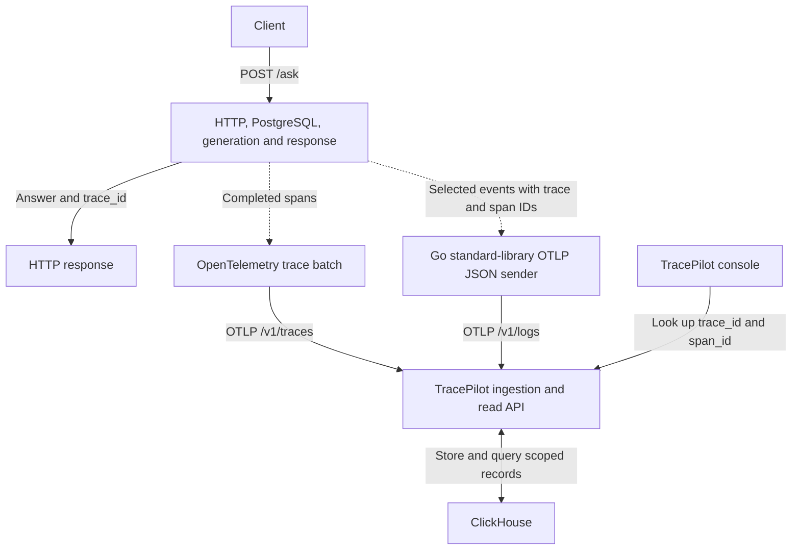

# TracePilot-only plan for request traces and logs

The operator starts with the `trace_id` returned by `POST /ask`. In TracePilot, that ID opens the request waterfall and the structured logs for each step. For the stale refund-policy case, the operator can identify that PostgreSQL returned policy version `1` and that generation used it, even though the endpoint returned HTTP `200`.

The demo's AI log sender uses only the Go standard library. The existing tracing SDK supplies trace context. The deterministic model and optional sandbox model use the same log event contract. [Source development roadmap](PRODUCT_ROADMAP.md)

## What is already available

| Area | Current implementation | Work for this plan |
| --- | --- | --- |
| Request instrumentation | `aidemo` emits HTTP, retrieval, PostgreSQL, generation, and response spans. It returns a trace ID in JSON. | Keep the existing spans and write structured messages while the corresponding spans are active. |
| Log production | `aidemo` writes structured events to stderr and optionally sends them directly to TracePilot over OTLP/HTTP. | Apply the same event contract to one real AI request path and measure delivery. |
| Ingestion and storage | TracePilot accepts OTLP spans and logs and stores both in ClickHouse. It reads correlation IDs from the OTLP log record. | Exercise this path with producer-generated traces and logs in one disposable-stack test. |
| Investigation | Trace detail loads related logs even when the trace API returns `404`. Span detail links to the Log explorer filtered by trace and span ID. | Verify the workflow with one real AI service and support role. |
| AI evidence | Direct export already includes policy and prompt versions and model metadata. Ingest redaction masks attribute names containing `token`, except the two GenAI usage counters when they are nonnegative integers. | Keep the first release metadata-only. Add opt-in content as a follow-up. |

[Demo producer](../backend/cmd/aidemo/demo.go) · [OTLP log normalizer](../backend/internal/ingest/otlp/normalize/log_normalizer.go) · [Trace detail](../frontend/src/features/traces/trace-detail.tsx) · [Span inspector](../frontend/src/features/traces/span-detail.tsx)

## Architecture and choices

| Approach | When it fits |
| --- | --- |
| **Explicit log events sent directly from the demo** | Use existing `slog` for stderr and hand a small set of typed events to a worker built with `encoding/json` and `net/http`. Call sites control the exported fields and correlation. Start here for the AI request path. |
| Standard-library `slog.Handler` forwarding directly to TracePilot | Useful if several packages already emit a consistent set of `slog` records. It reduces call-site changes and requires a filter to keep unrelated or sensitive records out of the export. |
| Structured stderr collected by an existing platform shipper | Useful if the platform already ships stdout or stderr. Application changes are small, and the shipper must map the IDs to native OTLP fields and preserve the project and environment. |



The demo already owns each active span. Read the trace ID and span ID there and pass them into the standard-library sender as strings. The sender writes the native OTLP JSON fields `traceId` and `spanId` as hexadecimal identifiers. Use the existing load generator payload and TracePilot decoder as the repository's interoperability references. [OTLP/HTTP JSON encoding](https://opentelemetry.io/docs/specs/otlp/#json-protobuf-encoding) · [Load generator](../backend/cmd/loadgen/workload.go) · [Receiver JSON decoder](../backend/internal/ingest/otlp/json.go)

## 1. Export correlated logs from the demo

- [x] Keep wiring and shutdown in `backend/cmd/aidemo/main.go`, request events in `demo.go`, and the wire types and worker in `log_export.go`. The sender adds no module dependencies.
- [x] Give both signals the same `service.name`, project ingest token, and `X-Environment`. Enable direct log delivery with `OTEL_EXPORTER_OTLP_LOGS_ENDPOINT`. Read `OTEL_EXPORTER_OTLP_LOGS_HEADERS` first and fall back to `OTEL_EXPORTER_OTLP_HEADERS`. Decode percent-escaped values. [OTLP exporter settings](https://opentelemetry.io/docs/languages/sdk-configuration/otlp-exporter/)
- [x] Record each event on its active span, pass both native IDs to the sender, and keep JSON output to stderr. The queue overflow test also checks that `/ask` continues returning the expected answer.
- [x] Give each log a stable message and a short set of structured fields. Keep raw SQL parameters, request bodies, model payloads, credentials, and raw provider errors outside the exported messages. Put the normalized failure category in `error.type`.
- [ ] Preserve existing incident behavior. The demo already marks failed spans, and TracePilot can also create occurrences from error logs. Use `WARN` for correlated failure logs in the first cut and verify that the request's extra logs do not create additional incident occurrences. [Incident candidate rules](../backend/internal/domain/incident/incident.go)

Proposed `backend/.env` settings for the direct pilot highlight the two receiver paths.

```dotenv
OTEL_EXPORTER_OTLP_TRACES_ENDPOINT=http://127.0.0.1:4318/v1/traces
OTEL_EXPORTER_OTLP_LOGS_ENDPOINT=http://127.0.0.1:4318/v1/logs
OTEL_EXPORTER_OTLP_HEADERS='authorization=Bearer%20<ingest-token>,x-environment=development'
```

Replace any existing per-signal endpoint or header settings that point to a different destination or scope. The log sender must read these settings explicitly.

| Log message | Active span | Useful fields |
| --- | --- | --- |
| `request.completed` | `POST /ask` | HTTP status and selected policy version when available |
| `policy.retrieved` | `policy.retrieve` | Policy identifier and selected version |
| `policy.lookup_failed` | `policy.retrieve` | Normalized failure category |
| `generation.completed` | `chat refund-demo` or `chat openai` | Provider, requested model, reported model when supplied, prompt version, and policy version |
| `generation.failed` | `chat openai` | Requested model, prompt version, policy version, and normalized failure category |

### Wire format and delivery behavior

This example records the selected policy version under its retrieval span.

```json
{
  "resourceLogs": [{
    "resource": {"attributes": [{"key": "service.name", "value": {"stringValue": "tracepilot-ai-demo"}}]},
    "scopeLogs": [{
      "scope": {"name": "tracepilot-ai-demo"},
      "logRecords": [{
        "timeUnixNano": "1800000000000000000",
        "severityNumber": 9,
        "severityText": "INFO",
        "traceId": "0123456789abcdef0123456789abcdef",
        "spanId": "0123456789abcdef",
        "body": {"stringValue": "policy.retrieved"},
        "attributes": [{"key": "demo.policy.version", "value": {"intValue": "1"}}]
      }]
    }]
  }]
}
```

- [x] Send `POST /v1/logs` with `Content-Type: application/json`. Use the OTLP `resourceLogs` → `scopeLogs` → `logRecords` envelope, a nanosecond timestamp serialized as a decimal string, numeric `severityNumber`, and an OTLP `AnyValue` for the body and each attribute. Set the resource `service.name` and a stable scope name. The disposable-stack smoke test confirms that TracePilot accepts the payload. [OTLP/HTTP request](https://opentelemetry.io/docs/specs/otlp/#otlphttp-request)
- [x] Start with one background worker and an in-memory queue of 256 records. Flush at 32 records, 32 KiB of encoded batch data, or after 250 ms, whichever comes first. Cap each encoded record at 1 KiB. When the queue is full, count and drop the incoming export record and keep the local JSON log. Treat these values as pilot defaults and tune them from measurements.
- [x] Use one reusable `http.Client` with a two-second request timeout. Support HTTPS and stop redirects so configured ingest credentials stay with the intended endpoint. Limit the response body before parsing.
- [x] Treat HTTP `200` with `partialSuccess.rejectedLogRecords` as a completed export with reported rejections. Count those rejections and keep the batch out of the retry path. Retry a transient connection failure or `429`, `502`, `503`, or `504` once within a five-second batch budget. Respect `Retry-After` within that budget and use a short delay with jitter otherwise. Reuse the original encoded records on retry so timestamps and IDs remain stable. Authentication, schema, and size failures end the attempt. [OTLP/HTTP response and retries](https://opentelemetry.io/docs/specs/otlp/#otlphttp-response) · [TracePilot log identity](../backend/internal/ingest/otlp/normalize/log_normalizer.go)
- [x] Track accepted batches, retries, rejected records, and dropped records in the demo. Report failures locally with a normalized category and a count. Keep diagnostics outside the export queue. Drain after HTTP shutdown within a bounded deadline. The test suite exercises concurrent shutdown and enqueue.

**Acceptance.** A wire-level test decodes the native `traceId` and `spanId` fields and resolves each log to its expected span. The caller receives the same trace ID in the JSON response. Queue overflow, partial rejection, exporter failure, and shutdown have tested results. An export outage leaves `/ask` available.

## 2. Verify the investigation in TracePilot

- [x] Run the deterministic 14-day and 30-day cases with direct OTLP against disposable PostgreSQL and ClickHouse. Send `{"policy_version":1}` for the stale case and `{}` for the current case. Both return five spans and three correlated logs.
- [x] Retrieve spans through `GET /api/v1/traces/{traceID}` and logs through `GET /api/v1/traces/{traceID}/logs`. Filtering by `spanId` returns the record for that operation. Mixed-case IDs resolve to the same records. An unsampled trace can return `404` while related logs are available. [Trace and log API](../backend/internal/transport/httpapi/features/traces/traces.go)
- [x] In the disposable-stack browser check, open the trace, select `policy.retrieve`, and use **Logs for this span**. The Log explorer returns only its `policy.retrieved` event. The unsampled request shows correlated logs when its trace query returns `404`.
- [ ] Repeat the browser check with the intended support role and confirm **Live Tail** shows a newly stored matching log.
- [x] Verify log isolation in a second project and environment. Verify that the receiver rejects invalid and revoked ingest tokens on the disposable stack.
- [x] Write a support procedure for investigating an HTTP `200` response with the wrong answer. [Support procedure](#support-procedure-for-an-incorrect-answer)

| Scenario | Expected evidence |
| --- | --- |
| Stale policy | HTTP `200`, 14 days, `policy.retrieved` shows version `1`, and generation links to the same trace. |
| Current policy | HTTP `200`, 30 days, `policy.retrieved` shows version `2`, and its logs appear under a separate trace ID. |
| Database failure | HTTP `500`, failed PostgreSQL and retrieval spans, and the correlated normalized failure message. |
| Model timeout | HTTP `504`, a failed generation span, and `generation.failed` with the timeout category. A local provider fixture is sufficient for the repeatable test. |
| Log export temporarily unavailable | `/ask` still responds, trace export remains independent, and the sender reports retries and drops. |

**MVP acceptance.** An operator can start with the stale response's trace ID and explain the 14-day answer from the selected version and its correlated logs in TracePilot. The UI uses the existing trace and log queries.

## 3. Apply the flow to an existing AI service

Start with one Go endpoint that retrieves context, invokes one model, and returns an answer. Use the demo as the reference for the wire format and tests. Keep the sender inside the producing service, with one worker initialized at process startup. Extract a shared package once a second producer has the same delivery and configuration needs.

| Step | Change in the service | Check before moving on |
| --- | --- | --- |
| 1. Capture the request | Extract incoming W3C `traceparent` or start a root span. Return the trace ID in the existing response shape or an agreed support header. Keep it searchable by customer support. | One returned ID opens the same scoped request in TracePilot. Invalid incoming context starts a new trace. |
| 2. Capture evidence at boundaries | Emit a retrieval event with source identifier and version, a generation event with provider, requested model, reported model and prompt version, and a completion event with status and outcome. Record child database and tool spans where they help explain the result. Use controlled message names and typed attributes. | A fixture with stale data and a fixture with a model failure are distinguishable using their trace IDs. |
| 3. Wire delivery in staging | Configure trace and log endpoints on the same project and environment. Give each producer its own ingest token, use HTTPS, and keep stderr available. Start with the demo's bounded queue and timeout values, then tune with measured load. | Trace and log arrival are independent. A receiver outage leaves the application response available and increases export failure or drop counters. |
| 4. Check security and diagnosis | Exercise project and environment isolation, rotation and revocation, mixed-case ID searches, unsampled requests, and sensitive-value fixtures. For replicas, measure how long revocation takes on a previously warmed instance before setting a security requirement. | A support user in the intended scope can isolate one span. A user outside it and a revoked producer fail authorization according to the deployment's requirement. |
| 5. Roll out to one service | Enable one staging producer, review request latency, delivery lag, and the drop rate. Enable one production producer after comparing the measurements with its latency budget and telemetry objectives. | Disable the log endpoint to roll back export while retaining local logging. Monitor export failures and queue pressure before adding services or agent steps. |

### Support procedure for an incorrect answer

1. Copy the trace ID from the response and select the matching project and environment in TracePilot.
2. Read the retrieval span and `policy.retrieved` to identify the source version. Open the generation span to confirm its model and prompt version.
3. Compare the data selection and model metadata with a known correct request. In the demo, version `1` explains the 14-day answer and version `2` explains the 30-day answer. Both return HTTP `200`.
4. If the trace lookup returns `404`, inspect **Correlated logs** or filter **Log explorer** by trace ID. Allow time for independent exports. Check sampling, retention and exporter diagnostics if spans remain unavailable.

### Readiness gaps to resolve before broad rollout

- [ ] Publish ongoing queue depth and outcome counters through the host application's existing measurement channel. The demo reports failures on stderr and summarizes counters on shutdown. Use staging traffic to measure p95 request overhead, delivery lag, and loss during a receiver outage.
- [ ] Agree on acceptable telemetry loss during process restarts and outages. The in-memory queue is appropriate for best-effort support telemetry. If the application needs guaranteed audit records, define a separate durable delivery requirement before using them for that purpose.
- [ ] Test token revocation across warmed replicas and during Redis failover. The current cache change protects an in-flight lookup against a revocation on the same cache instance. A different instance can still serve an entry until expiry.
- [ ] Approve a field allowlist with the service owner. Treat raw prompts, completion text, SQL bind values, document contents, and provider payloads as sensitive. Send identifiers and versions first, and verify redaction and scoped access before approving content capture.

## 4. Add AI evidence in TracePilot when needed

- [x] Preserve `gen_ai.usage.input_tokens` and `gen_ai.usage.output_tokens` as typed, nonnegative span counters when the provider supplies them. Add an exact, type-aware exception for the two counters before built-in substring masking while keeping explicitly configured redactions in effect. Test integer zero, absent values, invalid types, and nearby credential keys. The demo Collector still removes the counters from its TracePilot pipeline. [Current redaction rules](../backend/internal/ingest/otlp/normalize/normalizer.go)
- [ ] Evaluate opt-in input and output capture with the synthetic pilot first. Define which environment can capture it, which project roles can read it, how long it is retained, and which fields the producer may send. Keep production workloads metadata-only by default. Verify both capture settings and use the existing project scope where it satisfies those requirements.
- [ ] Store approved input and output as bounded span attributes under a generation or response span. Keep log bodies metadata-only. Record whether capture was disabled, omitted, or truncated. The ingest layer currently rejects oversized attributes, so enforce the value limit before export. [Ingest limits](../backend/internal/config/defaults.go)
- [ ] Start with the existing span inspector for the model, tokens, and approved content. Add a dedicated view only if the pilot investigation shows that grouping these fields materially improves diagnosis.

**Acceptance.** With capture disabled, the trace and logs expose only approved metadata. With the synthetic capture mode enabled, an authorized operator can compare the input, model output, and returned answer on the appropriate spans. A credential fixture is masked in both the API response and the console.

## 5. Verify release readiness

- [ ] Run the Go tests, `go vet`, and `go build`. Add a focused test for correlation and scoped reads. Run the disposable-store integration test and the browser investigation with representative credentials. Run type checking, tests, and build if the frontend changes.
- [x] Exercise queue pressure, partial rejection, a retryable `503`, a permanent `401`, and draining with `httptest`. Run the sender and revocation regressions under the race detector.
- [ ] Keep sample requests deterministic in CI. Use a separately configured provider for a sandbox run when real model metadata needs verification.
- [ ] Verify restart and exporter outage behavior. Measure request overhead and the time until both signals are queryable before extending the approach to a multi-service pilot.
- [ ] For the first multi-service flow, inject W3C `traceparent` on an outbound internal HTTP call and extract it on the receiving service. Verify that its spans and logs appear under the original trace ID.
- [x] Update `README.md`, `docs/FLOW.md`, `docs/diagrams.html`, and the Postman collection for the direct trace and log path. Track the real provider sandbox run separately.
