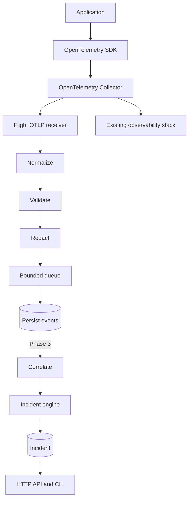
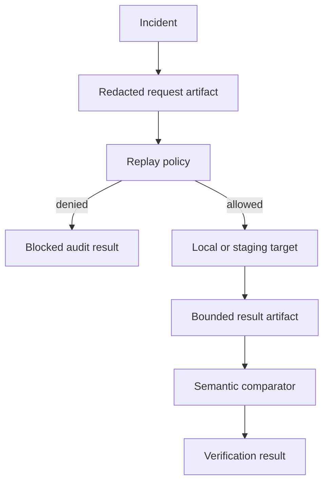

# Architecture

Flight begins as a modular monolith: one binary, one PostgreSQL database, and an optional filesystem artifact volume. This minimizes operational failure modes while preserving explicit domain and security boundaries.

> **Implementation status:** Phases 0–2 (OTLP ingestion, storage, and management health/metrics) are implemented and verified. The incident engine described below is Phase 3 design work and is **not yet implemented**.

## System flow

Applications are never required to route production requests through Flight. An existing Collector can fan telemetry out to Flight and the organization's current backend.

## Replay flow

Replay is not part of the ingestion process. Its workers, HTTP transport, database budget, timeouts, and queue are isolated so a slow target cannot affect telemetry admission.

## Data flow and durability

OTLP adapters decode bounded requests into canonical Events. Validation rejects malformed identifiers and timestamps; redaction removes configured secrets before an event can enter a queue. Batch writers persist idempotent event IDs. Phase 3 adds workers that claim durable work, correlate persisted events, and perform deduplication in a transaction.

The acknowledgement point is a committed event batch. If a future configuration permits memory-queue acknowledgement, it must be explicitly named as a weaker durability mode and expose possible-loss metrics.

## Concurrency ownership

The application runtime owns listeners, queues, and batch writers. Listener goroutines derive from the root cancellation context. Batch workers use an owned drain context so accepted events can commit after listeners stop; that context is cancelled if the shutdown deadline expires. Queue count/bytes, worker counts, batch sizes, flush intervals, and shutdown timeouts are finite and validated together. PostgreSQL pool budgets reserve one connection per ingestion worker plus management headroom.

Phase 3 correlation work is durable. Transaction-scoped PostgreSQL advisory locks serialize incident deduplication per project/environment/fingerprint across replicas. No process-local mutex is used as a distributed correctness mechanism.

## Failure behavior

| Failure | Behavior |
|---|---|
| PostgreSQL unavailable | readiness fails; bounded admission rejects/retries according to OTLP semantics; liveness remains healthy |
| Queue full | bounded wait, then partial-success/retryable response and rejection metric |
| One malformed record | reject that record where protocol permits; do not panic or log its body |
| Incident worker exits | supervisor cancels the component/runtime; durable claim expires for retry |
| Blob write fails | capture is dropped/marked failed; observed application request continues |
| Replay target fails | replay execution records failure; ingestion and management reads continue |
| Shutdown deadline | force-close, report undrained count, exit non-zero |

Flight's optional capture path is fail-open for the observed application whenever safely possible. Flight must not become a new availability dependency for production traffic.

## Storage boundaries

PostgreSQL stores ownership, normalized event metadata, incident state, correlation links, occurrence history, artifact metadata, and replay audit data. Dynamic OTel attributes use bounded JSONB. Queryable ownership/status/time fields remain typed columns.

Filesystem storage holds bounded bodies and replay artifacts behind opaque generated keys. The database stores size, type, hash, truncation flag, and key. The filesystem implementation is a V1 boundary; S3/MinIO implementations wait for a real deployment requirement.

ClickHouse is not a V1 dependency. If retention volume or query latency exceeds the documented PostgreSQL capacity envelope, a measured ADR may move event storage while keeping the canonical Event and incident domain unchanged.

## Security boundaries

Phase 2 maps a trusted Collector to one project/environment from server configuration; OTLP bodies and headers cannot choose either. Phase 4 replaces that boundary with authenticated project mapping and management scopes. Repository writes require the configured project ID. Redaction occurs before persistence. Blob paths are never user-controlled. Replay treats every URL, DNS response, redirect, and captured header as hostile.

See [security.md](security.md) for threats and required verification.

## Scaling path

1. Tune bounded batching and PostgreSQL indexes using measured load.
2. Add table partitioning/retention only when operational evidence justifies it.
3. Enable multiple Flight replicas after durable claims and cross-replica deduplication pass concurrency tests.
4. Consider object storage when filesystem volume semantics limit replicas.
5. Consider ClickHouse only when PostgreSQL event retention/query objectives cannot be met economically.

Kafka, Redis, CQRS, event sourcing, service mesh, and microservice decomposition are not default scaling steps.
