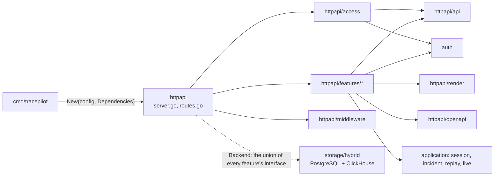
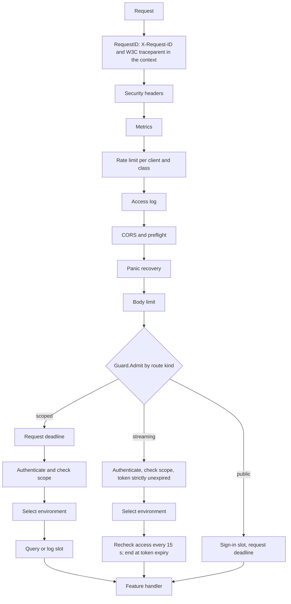

# HTTP API architecture

`backend/internal/transport/httpapi` serves the console's REST API, the OpenAPI document, health
checks, and `/metrics`. The root package only assembles the API. The security boundary, the shared
route contract, and each feature live in their own packages. This page explains how a request moves
through them and where new code belongs.

## Layout

```text
backend/internal/transport/httpapi/
├── server.go            Server, Dependencies, New, Run, middleware chain, rate-limit classes
├── routes.go            Backend, feature assembly, route registration, OpenAPI, CORS methods
├── api/                 the contract between the router and the features
│   ├── route.go           Route, Handler, header names
│   ├── errors.go          DecodeBody, Errors.Internal, Errors.Identity
│   ├── page.go            ListPage: parse page parameters, fetch, write the page and its cursor
│   └── project.go         RequireProject, VisibleProjects
├── access/              the security boundary
│   ├── guard.go           Guard, Admit, slot pools, request deadline, cache invalidation
│   ├── authenticate.go    access-token verification, principal, project and role lookup
│   ├── environment.go     environment selection
│   ├── stream.go          access checks for open streams
│   └── cache.go           short-lived project, role, and environment caches
├── features/            one package per resource
│   ├── session/           sign-in, refresh, sign-out, current user, password change
│   ├── users/             accounts managed by the super administrator
│   ├── projects/          projects, environments, retention
│   ├── members/           project members and the audit trail
│   ├── ingesttokens/      OTLP ingest tokens
│   ├── traces/            trace search and span pages
│   ├── logs/              log search and trace logs
│   ├── analysis/          topology, metrics, telemetry quality, services, performance
│   ├── incidents/         incidents, timelines, status changes, request replay
│   ├── webhooks/          webhook endpoints and deliveries
│   ├── stream/            live telemetry stream (SSE)
│   └── health/            /health/live, /health/ready, /metrics
├── middleware/          generic HTTP middleware with no TracePilot state
├── render/              JSON responses, error envelope, pagination, parameter parsing
├── openapi/             OpenAPI schema generation
├── apitest/             the assembled API against fake stores
└── integration/         the assembled API against real PostgreSQL and ClickHouse
```

Every feature package has the same shape:

- a `Backend` interface with only the storage methods the feature calls;
- a `Handler` built by `New` from that backend and the settings the feature needs;
- `Routes()`, which declares each route next to its handler, with the request and response types
  only that feature uses.

Unit tests sit next to the code and call handlers directly. `apitest` drives the whole router: scope
enforcement on every route, sessions, admission limits, and cross-feature rules.

### Why this split

The packages follow what changes together. A feature changes with its resource, so its routes,
handlers, and types sit in one folder. The checks every request needs, which are authentication,
scope, environment, slots, and the deadline, change together and form the security boundary, so
they live in `access`. The compiler keeps each feature to its own `Backend` interface. A handler
cannot reach storage it did not declare.

Features never import each other or `access`. They depend only on `api`, `render`, `openapi`, and
the domain and application packages. Projects and members clear the router's caches through
one-method interfaces that `access.Guard` satisfies.

## Dependencies



Dependencies point inward: no subpackage imports the root package. `routes.go` defines `Backend` as
the union of `access.Store` and each feature's `Backend`, and `cmd/tracepilot` passes the hybrid
store, so the transport never imports SQL code.

Some storage is optional. When the store does not implement the webhook, analysis insight, request
performance, or incident analysis interfaces, `routes.go` passes nil and those routes answer 501.
Webhook routes also answer 501 while notifications are disabled. Without a replay runner the replay
route is not mounted and the OpenAPI document leaves it out.

`Server` owns the router, the middleware chain, and the admission guard. It does not own the store,
the metrics registry, or the live stream hub. `cmd/tracepilot` creates and closes those and passes
them in `Dependencies`.

## Request lifecycle



The middleware order lives in one list in `withMiddleware`. The request ID and trace context come
first so the access log, error logs, and panic recovery can include them. The body limit wraps the
router directly.

`RegisterAPIRoutes` mounts each route through `Guard.Admit`, which picks the admission from the route
declaration. Scoped routes start the deadline before authentication because the user, project, role,
and environment lookups also wait for a pooled database connection. A request that cannot get a slot
within 500 ms gets `503 OVERLOADED` with `Retry-After`. Log reads use their own pool, and sign-ins
use another, so neither waits behind slow PostgreSQL queries.

## Authentication and authorization

```mermaid
sequenceDiagram
  participant C as Console
  participant A as access.Guard
  participant S as Storage
  C->>A: Authorization: Bearer access token
  A->>A: Verify signature, issuer, audience, expiry
  A->>S: GetUser(subject)
  A->>A: Reject disabled accounts and stale token_version
  A->>A: Temporary password allows only /auth/me and /auth/password
  alt session or platform scope
    A-->>C: Principal without a project
  else project scope
    A->>S: GetProject(path or X-Project-ID), cached
    A->>S: MemberRole(project, user), cached; the super administrator acts as owner
    A->>A: Scopes from the role must include the route scope
    A-->>C: Principal with project, role, and scopes
  end
```

- An access token only proves identity. Account state, the super administrator flag, and membership
  are read on every request, so disabling an account or changing a password ends its tokens.
- An unknown project and a project the caller cannot open both answer 403, so project names cannot
  be probed.
- Project and role lookups are cached for `TRACEPILOT_CACHE_IDENTITY_TTL` and environment lists for
  `TRACEPILOT_CACHE_SCOPE_TTL`. Handlers that change membership, rename a project, or add an
  environment clear the affected entries. A full cache starts over instead of evicting entries.
- The refresh token lives in an HttpOnly cookie on `/api/v1/auth`. The cookie is sent only with
  the `X-TracePilot-Refresh` header, and it is marked `Secure` in production, over TLS, or behind a
  trusted HTTPS proxy.
- `/metrics` is open outside production. In production it needs the scrape token or a signed-in
  super administrator.

## Errors

Every error uses one envelope:

```json
{ "error": { "code": "FORBIDDEN", "message": "...", "request_id": "..." } }
```

- `api.DecodeBody` rejects unknown fields and trailing documents and answers `400 INVALID_REQUEST`.
- `api.Errors.Identity` maps account and project errors from `internal/auth` to 400, 403, 404, or
  409 with stable codes.
- Features with their own domain errors map them in the feature, such as webhook validation errors
  in `features/webhooks`.
- `api.Errors.Internal` logs the cause once, with the request context so the line carries
  `request_id`, `trace_id`, and `span_id`. It answers `500 INTERNAL_ERROR`, or
  `504 QUERY_TIMEOUT` when the deadline expired. The response never includes the cause.

Handlers return after writing an error. Lower layers wrap errors with context and do not log them.

## Startup and shutdown

`New` builds the guard, the features, the router, and `http.Server` but does not listen.
`cmd/tracepilot` runs `Server.Run` as a critical component under its supervisor. `Run` listens,
marks the server ready, and serves until the application context ends. Then it:

1. marks the server not ready, so `/health/ready` answers 503;
2. closes the live stream hub, so SSE handlers return;
3. calls `http.Server.Shutdown` for up to `TRACEPILOT_APP_SHUTDOWN_TIMEOUT`, and forces the
   remaining connections closed if it expires.

The store is closed by `cmd/tracepilot` only after the supervisor returns, so active requests keep
their dependencies until they finish. The only goroutines the API starts are the serve loop in `Run`
and one access watcher per open stream, which stops with the stream's context.

## Adding an endpoint

1. Add the route to the feature's `Routes()` with its path, method, scope, operation ID, success
   status, and OpenAPI request and response types. For a new resource, create a package under
   `features/` with the same shape and add it to `featureRoutes` in `routes.go`.
2. Write the handler as a method of the feature's `Handler` with the `api.Handler` signature. Read
   the project and environment from the `auth.Principal` the router passes in, never from headers.
3. Decode bodies with `api.DecodeBody`, and serve paged lists with `api.ListPage`. Parse other
   queries with `render`. Pass `request.Context()` to every storage call.
4. If the handler needs a new storage method, add it to the feature's `Backend` interface and
   implement it in storage. The root `Backend` picks it up through the embedded interface.
5. Map expected errors explicitly and send everything else to `Errors.Internal`.
6. Add a unit test next to the handler. `apitest` checks the new route's scope enforcement through
   the OpenAPI document, and the root OpenAPI contract tests check its declaration. Update
   `docs/tracepilot.postman_collection.json`, and `docs/FLOW.md` when the flow changes.
