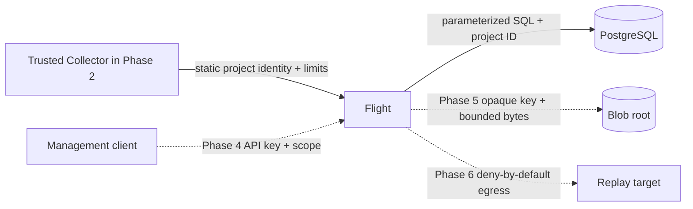

# Security and threat model

Flight handles hostile telemetry and potentially sensitive production payloads. Capture and replay remain disabled until their controls and adversarial tests are complete.

## Assets

- API and ingestion credentials
- captured request/response bodies and headers
- logs, traces, exceptions, and service topology
- project ownership and incident history
- replay authorization and audit records
- database and blob-storage integrity

## Trust boundaries



## Threat matrix

| Threat | Required control | Verification gate |
|---|---|---|
| Captured credentials/API keys | default sensitive header/key redaction before queue/storage; never log payloads | synthetic secret corpus absent from logs, DB, and blobs |
| PII/payment data | capture disabled by default; allowlisted content types/fields; retention/deletion policy | capture policy and deletion integration tests |
| Malicious/oversized OTLP | compressed/decoded/record/string/attribute limits; bounded queues; auth/rate budget | malformed protobuf, decompression, fuzz, and saturation tests |
| Oversized HTTP body | `MaxBytesReader`/bounded streaming; truncation marker; stream preservation | exact boundary and slow-reader tests |
| Replay SSRF | scheme/host/port allowlist; DNS/IP validation; controlled dialer; redirect revalidation; egress policy | metadata, link-local, private/public, IPv4/IPv6, alternate notation, redirect, rebinding fixtures |
| Replay against production | deny-by-default policy plus deployment network deny; explicit environment allowlist | configured production fixture remains unreachable |
| Credential replay | strip Authorization, Proxy-Authorization, Cookie, Set-Cookie, X-API-Key and configured headers | outbound capture asserts absence on initial and redirected requests |
| Filesystem traversal/symlink | generated opaque key; canonical root; no user paths; exclusive create; restrictive mode | `..`, absolute path, separator, symlink race tests |
| SQL injection | parameterized SQL; allowlisted sort/filter mapping | malicious filter and cursor integration tests |
| Log injection/leak | structured logging; no raw record/body/header; bounded normalized fields | captured log output assertions |
| Cross-project access | project derived from auth; repository requires it; composite FKs; non-enumerating errors | two-project API/repository isolation suite |
| API-key theft | high entropy, show once, hash at rest, scopes, expiry/revocation, constant-time verify | DB dump lacks usable key; revoked/expired/scope tests |
| DoS via management/replay | body/time/page limits; per-key rate budget; separate worker/DB pools | load test demonstrates ingestion isolation |
| Dependency/image compromise | pinned CI actions/images, review, govulncheck, SBOM, image scan | release pipeline evidence |

## Replay network policy

Application checks cannot fully prevent SSRF by themselves. Production deployment must also restrict Flight's egress to approved replay networks and deny cloud metadata endpoints. The executor must not use the default redirect policy. It validates every redirect and destination IP, caps redirect count, disables ambient proxy environment variables unless explicitly configured, and uses a dedicated transport with total and phase timeouts.

Allowed target policy is explicit per environment. URL userinfo is rejected. Hostnames are normalized before allowlist matching. All resolved addresses must be permitted; mixed safe/unsafe answers fail closed. Connection destination must be tied to the validated resolution to reduce DNS rebinding risk.

## Redaction order

```text
bounded decode -> validate shape -> redact -> enqueue -> persist
```

If structured redaction cannot safely parse a configured structured content type, capture fails closed for the body while metadata ingestion may continue. Redacted values use a constant marker and never preserve original length. Flight's own errors contain safe field names and offsets, not secret values.

## Blob rules

Artifact keys are generated UUIDs and never accepted from telemetry. The filesystem backend opens beneath one configured root, rejects symlinks, writes to a restrictive temporary file, syncs as required by durability policy, and atomically renames. A SHA-256 digest detects corruption. Database authorization is checked before resolving a key. Retention removes references and blobs with retryable, auditable cleanup.

## Authentication and tenancy

Phase 2 has no ingestion key and must remain behind a trusted network boundary; project/environment identity comes only from server configuration. Phase 4 introduces distinct ingestion and management keys. Management scopes are `read`, `replay`, and `admin`. Health access is a separate deployment policy. API responses do not distinguish “wrong project” from “not found.” Project ID is never trusted from a client-controlled JSON field when authenticated context already defines it.

V1 is not an enterprise isolation claim. Organizations requiring hard tenant isolation should deploy separate Flight instances/databases until a dedicated tenancy review is complete.

## Logging rules

Allowed operational fields include request ID, component, operation name, bounded duration, status, queue statistics, and safe error classification. Forbidden fields include bearer/API keys, cookies, raw headers, raw telemetry records, captured bodies, database URLs, and incident artifact content. Trace ID and incident ID may appear in structured application logs but never as metric labels.

## Security release gate

Before the first production release: complete all threat-matrix tests, run `govulncheck`, scan the image and SBOM, review Go/network/database dependencies, verify secret-free fixtures and logs, test backup/restore authorization, publish a monitored disclosure contact, and conduct an independent replay/redaction review.
